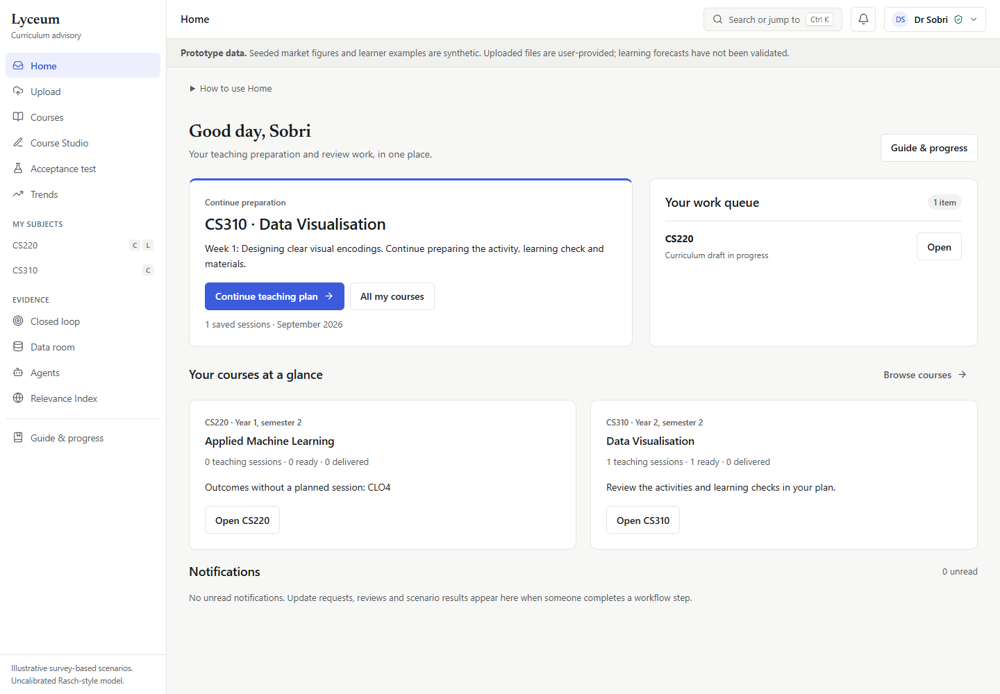
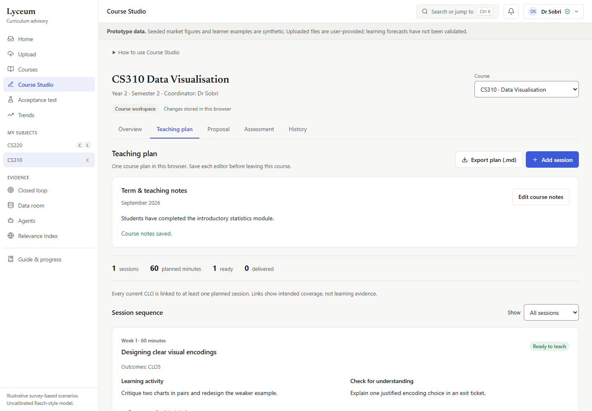
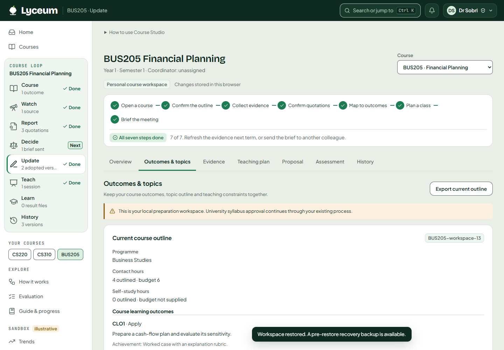
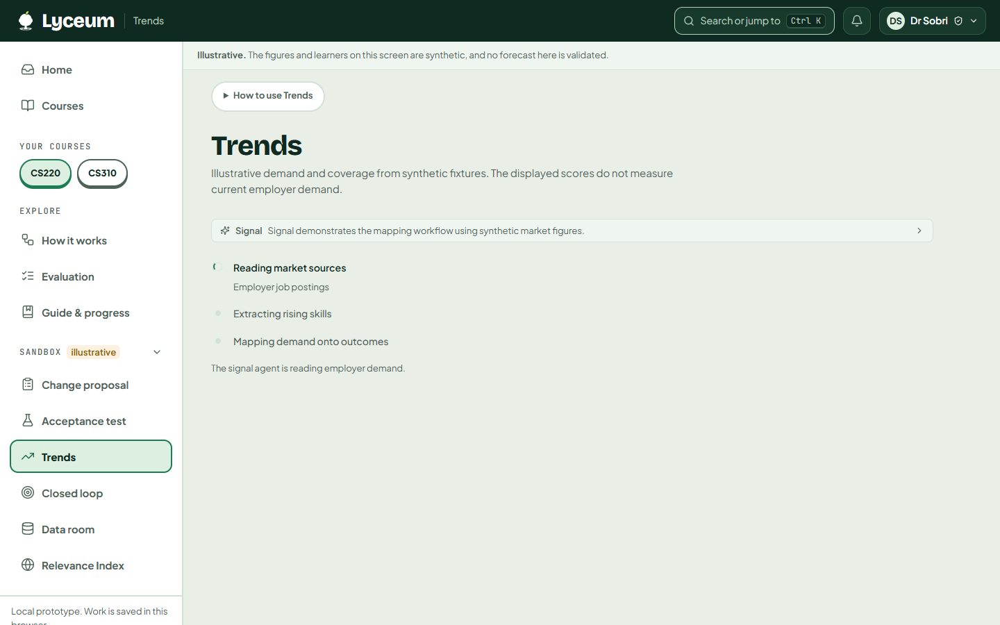
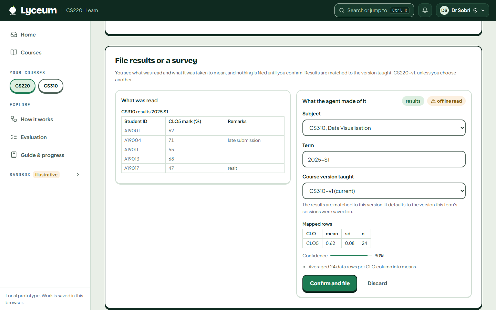
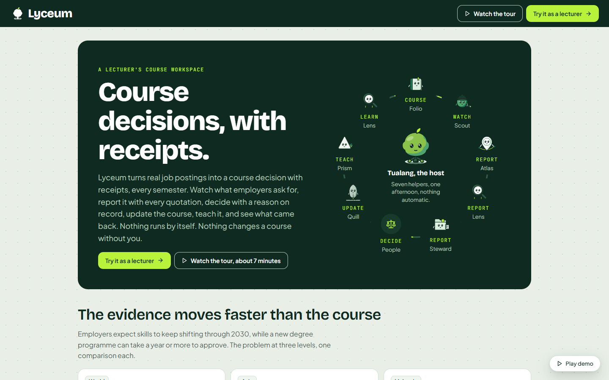

# Lyceum

**A curriculum-review prototype being developed into a lecturer's course workspace.**

The [upgrade plan](docs/lyceum-upgrade-plan.md) of 22 October 2026 is the current
direction: the Lyceum Loop (Watch, Report, Decide, Update, Teach, Learn), the forest and lime
design system with mascots, the maths of the Learn step, the doors through MCP and skills, and
the Amsterdam pitch, booth demo and video, with the research behind it in
[docs/research](docs/research/). The [improvement plan](docs/lyceum-improvement-plan.md) keeps the
execution records and the work packages: traceable industry evidence, reviewed CLO/topic changes, assessments,
editable teaching materials, and versioned academic review. It includes the
repository audit, proposed agent identities, calculation design, source-access
strategy, SDK/subscription options, accessibility requirements, and release gates.

The current app supports personal course creation, a complete manual CLO/topic
editor, course constraints, before/after comparisons, local version history,
CLO-linked teaching sessions, Markdown exports and validated JSON backup/restore.
It also retains the prototype's role personas, document parsing and review,
assessment editor, prerequisite checks, lecturer-supplied evidence receipts with
exact excerpts, and illustrative analytics.

Signed out, the app shows a public landing page: the pain with sources, the
five steps, what is proven and what is not built. Signed in, a seven-step
journey bar in Course Studio and a Start here card on Home read the saved work,
so a step is done only when the workspace holds its result. **How it works**
shows the seven roles and a timeline derived from real records for the selected
course; **Evaluation** shows live self-checks, a labelled scan benchmark, the
automated suites and the protocol for benchmarking the student-simulation agent
against course outcomes and surveys (not yet run on real data).
It is not yet a validated curriculum-rating or learning-prediction service:

- The research sandbox screens (Trends, Acceptance test, Closed loop, Data
  room, Relevance Index) use **synthetic fixtures** and say so on screen. Real
  postings exist only in a course's Evidence tab: fetched on request from the
  Greenhouse and Lever board APIs through the local API, or pasted by the lecturer.
- The seeded 200-learner cohort is synthetic. The historical backtest is a
  generated example, and S-0488 / ML-14 is a separately pinned illustration.
  The displayed error of 0.009 is not evidence of predictive accuracy in practice.
- The Rasch-style simulation uses heuristic ability/difficulty/penalty values.
  Topic edits are not a validated model of learning gains.
- Role switching is prototype state. Approval now applies the tested candidate
  to a local version with role and stale-review checks, but server-side identity,
  authorization and institutional verification remain to be built.
- Upload parsing is functional. A successful parse or an uploaded syllabus does
  not establish an official source; confirmation keeps institutional verification unset.
- Live model text can augment the agent panel, but the sandbox's structured
  drafts and scores still use fixtures. Teaching packs and brief decks are
  generated deterministically from saved data as editable PPTX, with a chart
  slide; model-drafted slide text is planned, not implemented.

## Lecturer workspace

Start with **Courses → Create course workspace → Outcomes & topics** or open an
assigned course. Record the course brief, CLOs, achievement evidence, PLO mappings
and topic sequence. Declare known hours and prerequisites. Save and check the
revision, inspect its changes and warnings, record a rationale and teaching term,
then explicitly choose **Use as my course version**.

That decision applies your entered outline and preserves the baseline and history.
It is local course preparation; official syllabus approval stays in the
university's existing process. Broken links, cycles, exceeded budgets and removed
protected content block a checked revision. Missing information stays visible
instead of becoming an arbitrary readiness score.

In **Evidence**, run a research run: fetch postings from a permitted employer
board (Greenhouse or Lever, through the local API) or the dated saved sample,
keep the ones worth reading, scan them for the skills you name, and confirm each
quotation in the source's exact words; a paraphrase is rejected. Mark the
postings reviewed so they count, map quoted skills to outcomes with a reviewed
coverage stage, then prepare a meeting brief with the table, the options and
every receipt, to download or to send to a colleague inside Lyceum. You can also
paste a document you are permitted to keep. Collection happens only when you
ask, and nothing changes the course by itself.

In **Teaching plan**, save sessions with CLO links, activities and learning checks,
and download any session as an editable **teaching pack (.pptx)** built from the
session and the evidence linked to its outcomes, with speaker notes and no AI
text. The meeting brief downloads as slides too.
A course change preserves affected teaching work and flags it for review.
Affected assessments cannot be approved again until their course-change review
is recorded and retired outcome links are repaired.

Use **Guide & progress → Workspace backup** or **Courses → Backups** to download
saved data and versions as JSON. Restore includes a file preview, validation,
replacement acknowledgement and a downloadable pre-restore recovery copy.
Markdown course/plan exports are readable documents; JSON is the restorable
workspace format. Original uploaded files and unsaved edits are excluded.

The core workflow needs **no paid AI subscription or API key**. Work is saved in
this browser only. Shared accounts, server permissions, term archives and
multi-device collaboration remain in development.

The **Guide & progress** page explains every section and lists unfinished work.
Every signed-in section also has a **How to use** disclosure. Read the full
[lecturer and section guide](docs/lecturer-guide.md) for instructions, outputs and
limitations. Regenerate it with `node scripts/generate-guide.mjs` when changing
the shared in-app section catalogue.

---

## Screenshots

The October lecturer workspace, using an example teaching plan entered during
the browser checks:







The remaining screenshots document the original v3 interface and predate the
October integrity and workspace improvements. Current screens explicitly label
the synthetic data.

**Trends.** The Signal example maps synthetic market figures onto course outcomes.



**Real intake.** What was read beside what the agent made of it; nothing files
until a human confirms.



**The public Relevance Index.** An illustrative rating view, accessible without signing in.



---

## Getting started

Requirements: Node.js 24 recommended (the scripts execute TypeScript directly)
and a modern browser. On Windows PowerShell, use `npm.cmd` if execution policy
blocks `npm.ps1`.

```bash
npm install
npm run dev        # web app on http://localhost:5173 + api on :8787
npm run build      # production build into dist/
npm run preview    # static UI; document parsing and live board collection need the API
npm run typecheck  # tsc --noEmit
```

Live model calls are optional. The API uses `ANTHROPIC_API_KEY`; consult
`.env.example` and confirm an available model before enabling it. Intake can
request structured interpretation; other calls primarily provide streamed text
alongside deterministic drafts. Without a key, local interpretation and fixtures
remain available. The Cohort and Curriculum components run deterministic code.
The complete document walkthrough needs `npm run dev`, but no model key.

## Proofs

The maths, the flows, and the intake pipeline are covered by deterministic
proof scripts (no UI, no network):

```bash
npm run prove          # the spine and the canonical numbers (12 checks)
npm run prove:backtest # the closed-loop backtest (4 checks)
npm run prove:flow     # store, roles, state machine, analogy, closed loop (28 checks)
npm run prove:signal   # the staged Signal reveal (12 checks)
npm run prove:intake   # every demo file parses, interprets, files (18 checks)
npm run prove:integrity # evidence edge cases and direct approval/rejection permissions (13 tests)
npm run prove:teaching # course scope, validation, preparation counts and export (10 tests)
npm run prove:curriculum # curriculum decisions, constraint checks, recovery and stale assessments (28 tests)
npm run prove:evidence # evidence receipts, citations, denominators, Wilson intervals, mappings and backups (13 tests)
npm run prove:collect  # board collectors: text extraction, normalisation, cache, rate limits, size and timeout (6 tests)
npm run prove:research # research run: import on request, exact proposals, bulk review, briefs and notifications (5 tests)
npm run prove:slides   # editable teaching packs and brief decks, unzipped and read back (3 tests)
npm run prove:benchmark # scan benchmark on a labelled set, metric arithmetic, live quotation re-verification (5 tests)
npm run prove:journey  # journey completion rules, the derived timeline, the sourced landing figures (3 tests)
npm run prove:all      # 160 checks total
```

Headless verification of the built app:

```bash
npm run build
node scripts/walk.mjs  # sign in, visit every screen, file a real upload, assert no errors
npm run smoke          # play the full-tour demo, assert the end state including both downloaded decks
npm run smoke:integrity # landing page free of synthetic figures, notice only on sandbox screens, split-source warning; local browser only
npm run smoke:workspace # lecturer save/reload/export, guides, keyboard and mobile checks
npm run smoke:curriculum # create/revise/version, evidence receipts and report, real downloads and restore, 320/390px checks
node scripts/generate-guide.mjs --check # in-app catalogue and Markdown guide agree
```

## For judges

**[JUDGES.md](JUDGES.md)** explains the prototype walkthrough and its limitations.
The current [as-built report, 9 October 2026](docs/lyceum-v3-as-built-2026-10-09.md) describes
the build as verified. The historical [as-built document](docs/history/lyceum-v3-as-built.md) contains claims that the
current [audit and improvement plan](docs/lyceum-improvement-plan.md) corrects.

## The self-driving demo

The **Play demo** control on the sign-in screen and **Guide & progress**, or
**Watch the tour** on the public landing page, plays a full tour of one course over the real app with a simulated
cursor, about five and a half minutes after three intro cards: a course revision under
constraint checks with its version history, a research run on a dated saved
sample of real postings, exact quotations with a rejected paraphrase, bulk
review, a coverage mapping, a teaching session with its slide pack downloaded, a
template assessment, a meeting brief with slides sent to the programme owner, the step-by-step
record on How it works, the guide and backup page, and the recipient reading
the brief. The counts,
quotations, decks and brief are computed live; only the postings are a saved
sample, labelled as such. Live board collection needs the local API and a
network connection. Press record, click Play once. Sample decks can be
generated with `node scripts/gen-sample-decks.mjs`. Regenerate the sample
postings from a raw board download with
`npm run gen:sample <board.json> <board> <retrievedAt>`.

## Project structure

```text
server/               the thin api: /api/parse (5 formats), /api/collect (two permitted board APIs, cached and rate limited), /api/agent (streaming, fallback)
public/demo/          real sample files: results.xlsx, clo-survey.csv, syllabus.pdf, lecture-slides.pptx, collected-sample.json (dated postings)
src/
  types.ts            the Layer 0 data contract
  theme/              tokens + global styles (one system, no ad-hoc styling)
  lib/                curriculum constraints/diffs/exports, teaching plans, evidence receipts and calculations, board collection, slide packs, validated workspace backups
  lib/spine/          the illustrative Rasch spine (pure maths, reused from v2 byte-identical)
  data/               seed, cohorts, items, the multi-source market snapshots
  agents/             the seven agents: client wrappers, local interpreters, fixtures
  app/                store (persistent), roles, staged simulations
  ui/                 primitives, shell, course creation/revision, recovery and other screens
  demo/               the self-driving demo: the research-run script, runner and overlay
scripts/              generators and headless verification
```

## License

Copyright (c) 2026 Hafiz Azman. All rights reserved. Proprietary software; see
[LICENSE](LICENSE).
