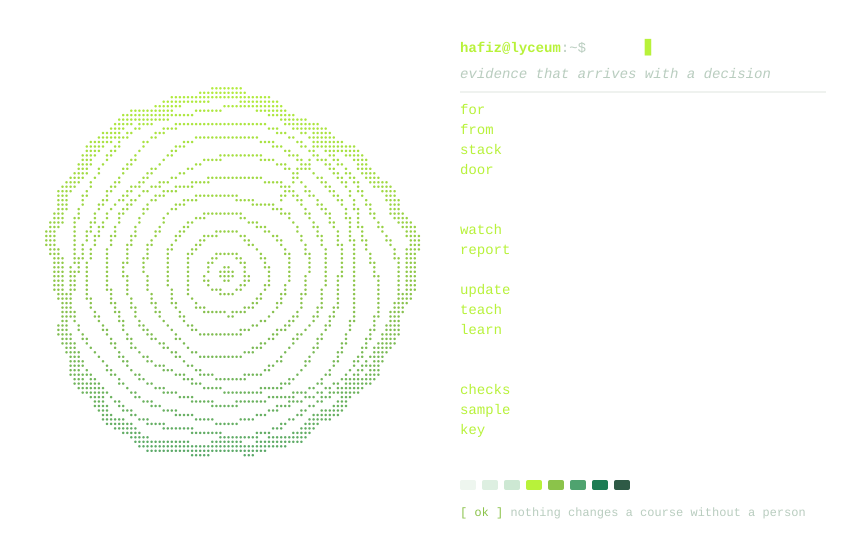
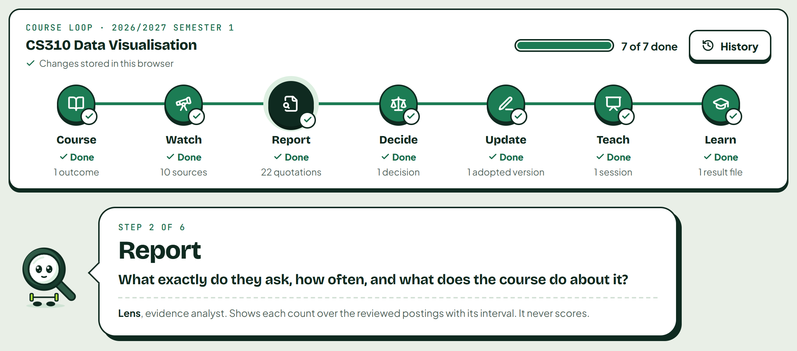
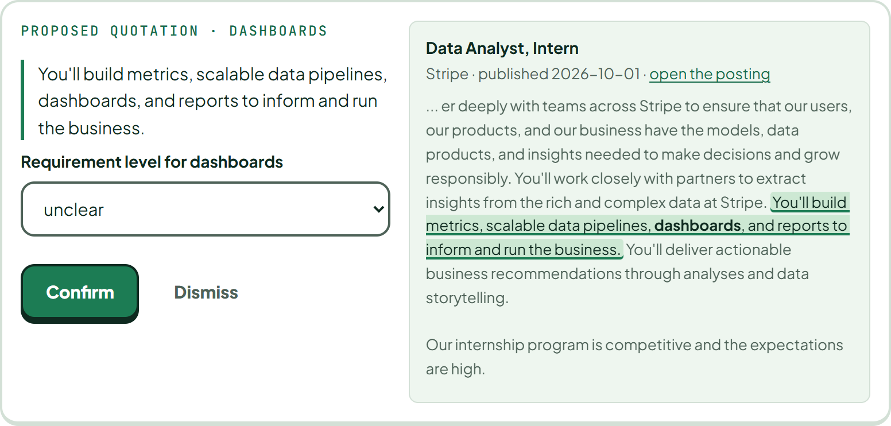
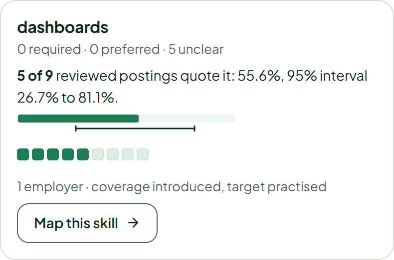
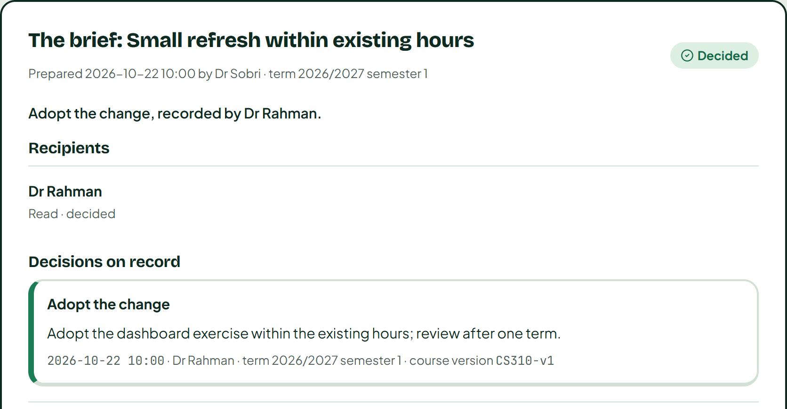
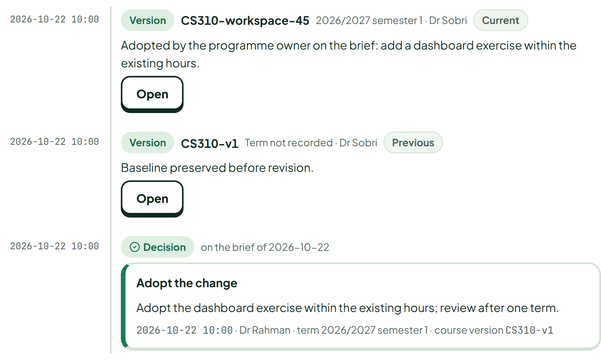
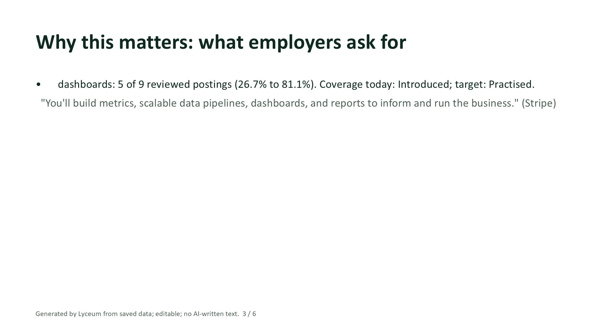
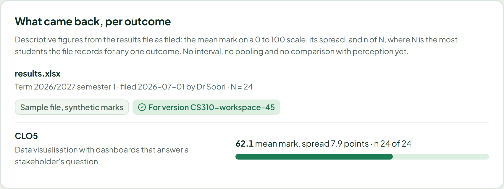
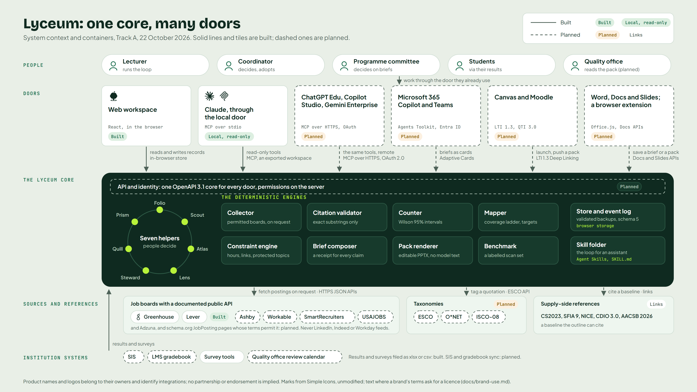

<div align="center">
  <picture>
    <source media="(prefers-color-scheme: dark)" srcset=".github/readme/banner-dark.svg">
    <source media="(prefers-color-scheme: light)" srcset=".github/readme/banner-light.svg">
    
  </picture>
</div>

<div align="center">
  <picture>
    <source media="(prefers-color-scheme: dark)" srcset=".github/readme/card-dark.svg">
    <source media="(prefers-color-scheme: light)" srcset=".github/readme/card-light.svg">
    
  </picture>
</div>

<p align="center">
  <a href="#hafizlyceum-npm-run-proveall"></a>
  <a href="#hafizlyceum-open-report"></a>
  <a href="LICENSE"></a>
</p>

```text
hafiz@lyceum:~$ cat ./about
lyceum turns real job postings into a course decision with receipts,
every semester, inside the tools lecturers already use. one loop of six
steps per course and term: watch, report, decide, update, teach, learn.

hafiz@lyceum:~$ npm run prove:journey | grep -E "^ℹ (tests|pass|fail)"
ℹ tests 9
ℹ pass 9
ℹ fail 0
```

### <samp>hafiz@lyceum:~$ cat ./problem</samp>

Curricula move slower than the work they prepare students for. Approving a new degree programme generally takes 12 to 18 months, while 39% of workers' existing skills are expected to be transformed or outdated between 2025 and 2030 (World Economic Forum, Future of Jobs Report 2025; the approval pages of Wayne State and Texas Tech). The two figures describe different populations, so they are never drawn as one chart. The accreditors already ask for evidence from employers at every review; what a lecturer lacks is a way to show it. Every figure on every Lyceum surface is registered with its source in [docs/claims.md](docs/claims.md).

A lecturer can suggest a change before the next review, but cannot show why: no exact sentences from employers, no denominator, no record of who decided. Lyceum keeps all three.

### <samp>hafiz@lyceum:~$ open ./loop</samp>

<p align="center">
  
</p>

| step | the question | the record it leaves |
|:--|:--|:--|
| Course | What does this course promise today, and for which term? | the course record, in the shape of a course file, and the term every later record carries |
| Watch | What are employers asking for, right now? | postings fetched on request from a permitted board, each with its link, date and fingerprint |
| Report | What exactly do they ask, how often, and what does the course do about it? | exact quotations, the reviewed denominator, counts with Wilson intervals, a mapping, the brief |
| Decide | What will we do, and who said so? | a decision record: adopt, retain, defer or return, by whom, when, why, on which brief, version and term |
| Update | What does the approved change look like, within our hours? | a checked revision, adopted as a new version, the old one kept, with the before and after and the decision behind it |
| Teach | What will the class do, and with what? | a session linked to an outcome and its editable teaching pack |
| Learn | Did it work, as far as we can honestly tell? | the term's results, matched to the version taught, against a stated pass mark with n of N, and the OBE course report |

A host, Tualang, and seven helpers do the work; at Decide there is no helper, because people decide. Nothing runs by itself and nothing changes a course without the lecturer.

### <samp>hafiz@lyceum:~$ open ./report</samp>

<table>
  <tr>
    <td width="50%"><samp>a quotation proposed beside its source</samp></td>
    <td width="50%"><samp>counted over reviewed postings, with its interval</samp></td>
  </tr>
  <tr>
    <td></td>
    <td></td>
  </tr>
</table>

A requirement is an exact substring of its saved source, or it is refused; a paraphrase typed by hand fails on screen. The count is over the postings the lecturer reviewed, with its Wilson interval, never over everything fetched.

### <samp>hafiz@lyceum:~$ open ./decide</samp>

<table>
  <tr>
    <td width="50%"><samp>the decision, with its reason, term and version</samp></td>
    <td width="50%"><samp>the adopted version, with the old one kept</samp></td>
  </tr>
  <tr>
    <td></td>
    <td></td>
  </tr>
</table>

### <samp>hafiz@lyceum:~$ open ./teach-and-learn</samp>

<table>
  <tr>
    <td width="50%"><samp>the teaching pack, as powerpoint draws it</samp></td>
    <td width="50%"><samp>results matched to the version taught</samp></td>
  </tr>
  <tr>
    <td></td>
    <td></td>
  </tr>
</table>

The screenshots are real captures of the app in its demo mode, on the dated saved sample of Stripe's public job board (`npm run shots`); the results on Learn come from the app's sample file and their marks are synthetic, as the screen says; the pack slide is PowerPoint's own rendering of the downloaded file. They record the build of 22 October, morning: the course record, the sample sessions with their branded packs, the before and after, the judge's walk, the term recap, the two student surveys and the OBE course report came later that day and are captured once, at the end.

### <samp>hafiz@lyceum:~$ npm run dev</samp>

Node.js 24 (the scripts run TypeScript directly) and a modern browser. On Windows PowerShell, use `npm.cmd` if the execution policy blocks `npm.ps1`.

```bash
npm install
npm run dev        # the web workspace on http://localhost:5173 and the local API on :8787
npm run build      # the production build into dist/
npm run preview    # the workspace alone; parsing and live collection need the API
npm run booth      # the built app on this laptop's network beside the API, for the survey on phones
```

The core needs no AI key and no account: work is saved in this browser. Live board collection (Greenhouse and Lever) and document parsing go through the local API; the dated saved sample works without it. **Watch the tour** on the landing page plays the whole loop over the real app in about 7 minutes; **For judges: walk with Tualang** opens the judge's page (`#/judge`), where the walk takes ten stops over the real app on the sample workspace, Next, Back and Esc by hand. [JUDGES.md](JUDGES.md) is the five-minute way in.

### <samp>hafiz@lyceum:~$ npm run prove:all</samp>

| suite | checks | what it proves |
|:--|:--|:--|
| Acceptance scenario (illustrative spine) | 12 | canonical numbers of the synthetic scenario |
| Backtest (synthetic) | 4 | closed-loop arithmetic on synthetic data |
| Flow and roles | 28 | store, permissions, state machine |
| Signal reveal (fixture) | 12 | the staged fixture reveal |
| Intake parsing | 22 | xlsx, csv, pdf, pptx parse and interpret; each results column on its own course's outcome by label, the listed students, the marks kept sorted with no identifier and the missing counted |
| Integrity | 13 | evidence edge cases, approval guards |
| Teaching plans | 10 | scope, validation, export |
| Curriculum | 28 | revisions, constraints, adoption, recovery |
| Evidence | 13 | citations, duplicates, Wilson intervals, mappings, backups |
| Collector | 6 | text extraction, cache, rate limits, timeouts |
| Research run | 5 | import on request, exact proposals, briefs, decisions and events in backups |
| Slides | 3 | decks unzipped and read back, chart part included |
| Benchmark and self-checks | 5 | labelled scan set, metric arithmetic, live quotation re-verification, denominator rules |
| The loop and the record | 9 | done rules per term, the decision record, a new term, the event log first in the timeline, Learn matched to the version taught, the term set inside the ring, the routes, every landing figure in the claims register and every quoted clause in its note |
| Evidence snapshots | 6 | frozen windows, change called only when intervals separate, identity matching, backups |
| Moods | 8 | each mood a pure function of the records, the requests in flight and the clock |
| The local door | 6 | every MCP tool through the protocol against the sample workspace: receipts, the export time, read-only annotations, the course record with the course file's manifest, attainment as the app shows it with a seeded file never counted, the pack never overwriting, nothing written to the workspace, refusals and the call log |
| The course record | 12 | the sample course in both states, its learning time, the assessment plan and its table of specifications, the matrix levels, the references gap, the rubrics, the tour's revision through the store, and the course file with its manifest |
| Teaching material | 8 | the fourteen sample sessions and their packs read back slide by slide, 18 pt body text, the mark and the demo line in every master, the repair of the parts pptxgenjs declares but does not write, the preview against the file, and samples kept out of the term's teaching |
| Before and after | 8 | the word diff, topic hours before and after, the week 6 pack under each version, a region for every changed part, renamed and added slides, results marked not comparable when an outcome is reworded, the summary in words, and the decision behind each version |
| The judge's way through | 5 | every walk stop rendered by its screen, captions within twenty words with their labels, the host at the two ends only, the not-built list word for word, the sample workspace restored with the current one kept, and the recap's numbers against their records |
| The two student surveys | 8 | the instruments from the record and the profile, the link under 2,000 characters with no secret in it, the collector's token against its own hash, the floor and the release showing nothing early, one response per device and booth responses never as evidence, the Microsoft Forms importer on its fixture, backups, and the sample's counts |
| Attainment against a stated threshold | 10 | the direct line against a hand-computed fixture with missing marks, no interval at a census and the finite-population interval below it, the recomputation after a change to the pass mark with the saved report keeping its own, the survey beside the marks never averaged and never from the booth, the programme outcomes listed with no index, marks without identifiers, the CQI note, Lens's moods, and backups |
| **total** | **241** | twenty-three suites |

After `npm run build`, four headless browser runs drive the built app: `npm run smoke` (the whole tour, the decision record, both downloads, the closed ring), `smoke:integrity` (the landing page carries no synthetic figure; the judge's page shows the register's figures and the not-built list word for word), `smoke:workspace` (save, reload, export, keyboard and 320 px layouts; the judge's walk by keyboard and the course file with its manifest; the survey's booth round trip from a 320 px phone) and `smoke:curriculum` (Watch to Update with real downloads and a restore; the before and after at 320 px). `npm run deck` checks every figure in the pitch against the claims register; `node scripts/generate-guide.mjs --check`, `node scripts/contrast-check.mjs` and `node scripts/dash-scan.mjs` keep the guide, the palette and the prose honest. These are software checks, not learning validation. Results with dates: [docs/as-built.md](docs/as-built.md).

### <samp>hafiz@lyceum:~$ tree ./architecture</samp>

<p align="center">
  
</p>

```text
src/lib/            the deterministic core: evidence, counts, curriculum checks, decisions, slides, backups
src/app/            the store, the loop and its ring, roles, moods, routes, the term recap
src/data/sample-course/  the demo course record and its term's material, labelled synthetic
src/demo/           the tour and the judge's walk over the real app
src/ui/             primitives, the shell, one screen per loop step, the mascots
src/prove-*.ts      the checks
server/             the local API: parsing, permitted board collection, the booth's survey collector
mcp/                the local door: a read-only MCP server over an exported workspace
skills/lyceum/      the skill folder for an assistant
deck/               the pitch, an HTML deck with its PDF and PPTX export
video/              the film: script, storyboard, style, the capture and the Remotion project
scripts/            generators and the headless browser runs
docs/               the plan, the as-built record, the claims, the decisions, the research
```

### <samp>hafiz@lyceum:~$ cat ./decisions</samp>

1. **Deterministic core, AI at the doors.** Counts, quotations and decisions come from code, so a number never depends on a model; an assistant reaches Lyceum through the door and may draft, never confirm or decide. The cost: no model writes slides or quiz items yet, so the lecturer writes them.
2. **Exact quotations or nothing.** A requirement is a substring of its saved source, or it is refused; reviewed postings form the denominator. The cost: a lecturer confirms every quotation and reviews every posting a count uses.
3. **One decision record.** Adopt, retain, defer or return, immutable, bound to the brief, the version and the term; a decision on one's own brief is self-recorded and stays open until a second person confirms. The cost: a second person, which a small department may not have.
4. **Local first.** One course runs in the browser with no account, and backups are validated JSON. The cost: no shared workspace, no sign-in and no server-side permissions until the department tier.
5. **The look from one file.** Every colour comes from `src/theme/tokens.ts`, checked against the WCAG audit by `scripts/contrast-check.mjs`, and the fonts are bundled. The cost: a new colour is a change to the audit first.
6. **A labelled demo course.** The demo's CS310 is a course record written for this prototype at UTP, the team's own university, and labelled demo and synthetic wherever it shows (the team's advisor confirmed the team represents the university); the mark appears only on the demo course, with the demo line beside it. The cost: every surface that shows the mark carries the line, and the lecturer's own courses carry neither.

Every decision of the build, dated, with its options and how to reverse it: [docs/decisions.md](docs/decisions.md).

### <samp>hafiz@lyceum:~$ ls docs</samp>

| file | what it is |
|:--|:--|
| [lyceum-upgrade-plan.md](docs/lyceum-upgrade-plan.md) | the plan for Amsterdam and after |
| [lyceum-depth-plan.md](docs/lyceum-depth-plan.md) | the depth plan: the course record, the material, the before and after, the judge's way through |
| [as-built.md](docs/as-built.md) | the system as built, with every verification run and its date |
| [claims.md](docs/claims.md) | every number on every surface, with its source |
| [decisions.md](docs/decisions.md) | every choice made in the build, with its trade-off and how to reverse it |
| [doors.md](docs/doors.md) | the local door, its tools and how to connect it |
| [demo-script.md](docs/demo-script.md) | the booth walkthrough: what to do, what to say, what not to claim |
| [brand-use.md](docs/brand-use.md) | each third-party mark shown, where it came from, and its terms |
| [lecturer-guide.md](docs/lecturer-guide.md) | every screen, generated from the in-app guides |
| [research/](docs/research/) | the dated research notes behind every figure |

### <samp>hafiz@lyceum:~$ git log --phases</samp>

Built for the Grand Final, package by package, each with its checks in [docs/as-built.md](docs/as-built.md):

- **The theme and the shell.** The tokens as the only source of colour, bundled fonts, the loop rail and the contrast check.
- **The loop.** Watch, Report, Decide, Update, Teach and Learn as screens, the decision record, the event log and the ring per term.
- **The cast.** The host and seven helpers drawn in code, their moods a function of the records.
- **The local door.** A read-only MCP server over an exported workspace, with the skill folder.
- **The pitch and the print.** The HTML deck with its PDF and PPTX, the architecture diagram, the brief and the A1 poster.
- **The film.** Two cuts built on a capture of the real app; silent until the team records the voices.
- **The course record.** The demo course in the shape of a course file: outcomes and the CLO to PLO matrix, the assessment plan and rubrics, the schedule, learning time and references, exported as a zip with an honest manifest.
- **Teaching material.** Fourteen labelled sample sessions, four with full slides, branded packs with a preview on screen, lab sheets and the project brief.
- **Before and after.** The change as a redline, the hours as current against proposed, the week's pack under both versions, and the decision behind each version.
- **The judge's way through.** The judge's page with Tualang, a ten-stop walk on the sample workspace, and a printable term recap.
- **The two student surveys.** The Course Outcome Survey and a demo SSRT from the course record, answered on a phone through a QR at the booth, with a response floor, a release rule and a Microsoft Forms importer; booth answers never count.
- **Attainment against a stated threshold.** Each outcome's share at the institution's pass mark with n of N, an interval only when some students have no mark, and the OBE course report saved as printed, with the survey beside the marks, the programme outcomes listed and the CQI note.

In progress for the final, as the days allow: assessment items with a Moodle export, the remaining survey importers and the paste code, and the animated compare views.

Next, in the order a pilot needs it (plan Section 17.2):

1. **Watch over time.** Snapshots as records, comparable windows, scheduled runs with failure reporting.
2. **Learn's maths.** The adequacy meter, partial pooling, the frozen prediction and its score, and the programme's PLO figure from every course's data.
3. **The shared core.** An API, identity, server-side permissions, tenancy and the audit log.
4. **The remote and LMS doors.** MCP over HTTP with OAuth for the assistants a university already runs; LTI 1.3 for its LMS.
5. **More sources, drafted materials, the pilot.** Further boards and taxonomies, model drafts reviewed sentence by sentence, the accessibility audit, and three to five lecturers for a term.

### <samp>hafiz@lyceum:~$ cat ./not-chased</samp>

- **Representative labour-market counts, employability scores, learning gains.** Lyceum counts what was collected, over a stated denominator, and claims no gain until the benchmark has run.
- **Feeds the boards do not permit.** Never LinkedIn, Indeed or Workday; only employer boards with a documented public API, read on request.
- **Formal approval.** It stays in the university's process; Lyceum records the decision that feeds it.
- **Predictions about a real cohort.** Nothing predictive runs on a real course; the planned protocol freezes a prediction before a term and scores it after, against the last cohort carried forward.
- **Accreditation.** The course file follows the order EAC lists and names what it does not hold; no course is claimed accredited or accreditable.

### <samp>hafiz@lyceum:~$ cat ./licences</samp>

| part | licence |
|:--|:--|
| Lyceum | proprietary, all rights reserved ([LICENSE](LICENSE)) |
| Bricolage Grotesque, Plus Jakarta Sans, JetBrains Mono | SIL Open Font License, bundled from Fontsource (`public/fonts`) |
| Simple Icons | CC0 as a project; each mark keeps its owner's terms ([docs/brand-use.md](docs/brand-use.md)) |
| The Universiti Teknologi PETRONAS mark | the university's own; shown on the demo course on the team advisor's confirmation that the team represents the university, labelled demo ([docs/brand-use.md](docs/brand-use.md)) |
| Remotion (the film only) | Remotion's own licence; which tier applies is open ([video/README.md](video/README.md)) |

<sub>The banner and card are generated by <code>.github/readme/build.py</code> (standard library Python). Change a value at the top and run it again.</sub>
