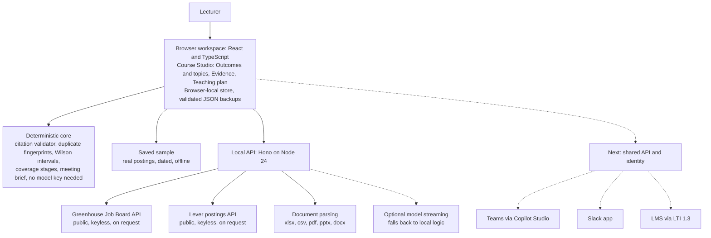

# Lyceum: travel fellowship pitch pack (9 October 2026, 9 am)

Everything you need for the organizer presentation, in one file: the order of work for the next hours, the five-minute script, the slide content, the live demo path with its proof points, the architecture, the market numbers with sources, the questions you will get, and prompts you can hand to Claude or ChatGPT. Every claim in here is true of the build verified on 9 October 2026; do not let any tool add a claim that is not in this file.

## 1. The next hours, in order

| When | Do | Why |
|---|---|---|
| Now, 15 min | Read Section 2 (the script) once aloud with a timer. | You must own the words before anything else. |
| +15 min, 20 min | Pre-flight the live demo (Section 4): `npm run dev`, open the app, sign in as Dr Sobri, fetch the Stripe board once, run the 90-second path by hand. | Finds any problem while you can still fix it, and warms the cache. |
| +35 min, 10 min | Record the backup video (Section 6): the Play demo end to end, then the 90-second live path. | If the venue network or the laptop fails, you still show the real thing. |
| +45 min, 30 min | Open the deck (Section 3 is its content). Fix wording you would not say, nothing else. | The deck exists; polishing it is the lowest-value use of your time. |
| +75 min, 30 min | Two full rehearsals, timed, deck plus demo. Cut until it fits five minutes. | Timing is what organizers notice. |
| Then | Sleep if you can. Charge the laptop. Put the MP4, the deck and the exported brief on a USB stick. | Nothing is worth presenting tired and without a fallback. |

Do not start new features, new research or new numbers tonight.

## 2. The five-minute script

If you get thirty seconds: "Lyceum is a lecturer's workspace that turns real employer postings into a course decision with receipts. The lecturer runs the research when a decision needs it, confirms every quotation, sees honest counts, and takes a brief to the meeting. It works today, offline, without an AI key. I am asking for travel support to present it and recruit pilot lecturers."

Timings add to 300 seconds including the demo.

**Slide 1, Title, 15 s.** "Good morning. Lyceum is a course workspace for lecturers. In five minutes I will show you a real research run, from a real employer's job board to a brief a lecturer can take to a meeting, and I will tell you exactly what is built and what is not."

**Slide 2, Value: the problem, 35 s.** "A lecturer who wants to refresh a course has three jobs: find out what employers actually ask for, work out what the course already covers, and defend the change to colleagues and the quality committee. Today that evidence lives in browser tabs, inboxes and memory, and the decision is hard to explain later. In Malaysia, DOSM counted 5.98 million graduates in 2024 with unemployment at 3.2 percent but underemployment at 32.2 percent, and MOHE reviews courses for relevance. The lecturer sits between those two facts with no tool built for them."

**Slide 3, What Lyceum does, 45 s.** "Lyceum is not a set of agents that run by themselves. It is what a careful lecturer would do anyway, faster and with receipts. Five steps. Search: fetch postings from a permitted employer board when you ask. Read: name the skills you care about, and confirm each quotation in the posting's exact words; a paraphrase is rejected. See the trend: counts with the denominator in view and a confidence interval, never a score. Decide: map a skill to a course outcome and choose keep, refresh or revise. Brief: a document with every receipt, to download or to send to a colleague inside Lyceum. Nothing runs by itself and nothing changes the course without the lecturer."

**Slide 4, Live demo, 90 s.** Do the Section 4 path. Say only the lines marked there.

**Slide 5, Validate: what is real, 35 s.** "What you saw is the shipped build. 149 automated checks, four headless browser runs and the self-driving demo pass on the current code. The live collectors were verified this week against the Stripe board on Greenhouse, 727 postings, and the Palantir site on Lever, 313 postings. No AI key is needed for any of it. Any saved session also downloads as an editable slide pack, and the brief downloads as slides, generated from the receipts with no AI text. What is not built: page collectors for employer sites that have no API, shared accounts, the Teams and Slack surfaces, and model-drafted slide content. The earlier screens that use synthetic market figures are labelled as illustrative and were not in the demo."

**Slide 6, Verify: how it runs, 25 s.** "The architecture is deliberately small. A browser workspace with a local store and validated JSON backups. A thin local API that only reaches two documented public job-board hosts, with a cache, rate limits and size limits. The core is deterministic: citation validator, duplicate fingerprints, Wilson intervals, coverage stages, the brief. The next step is a shared API and identity, and that is also the door into Teams, Slack and the LMS, so a university does not have to adopt another platform."

**Slide 7, Venture: market and plan, 30 s.** "The numbers are labelled estimates. Malaysia has roughly 45,000 lecturers across about 400 institutions; the world has over 22,000 accredited institutions. Lightcast and Chmura sell alignment to institutions from above, with global datasets and scores. Lyceum sits at the lecturer's desk and inside the tools they already use. The plan is a pilot with three to five lecturers measuring task completion, citation fidelity, time to a brief and repeat use, before any licence."

**Slide 8, The ask, 25 s.** "I am asking for the travel fellowship to present Lyceum at [event], to recruit pilot lecturers there, and to bring back measured results. You have seen a working, honest prototype. The lecturer keeps authority; Lyceum supplies the receipts. Thank you."

## 3. Slide content (paste into any deck tool)

Keep one message per slide, at most four lines of on-screen text, real screenshots from the app, no stock images, no invented charts. Tag each slide with the five V it answers (AWS framework: Value, Visualize, Validate, Verify, Venture).

**Slide 1. Lyceum**
Subtitle: Research the lecturer runs: from employer demand to a course decision, with receipts.
Footer: Hafiz Azman, [university], 9 October 2026. Travel fellowship pitch.

**Slide 2. Value: a course change has to be defended with evidence nobody keeps**
- Find what employers ask for. Work out what the course covers. Explain the change to colleagues and reviewers.
- Today: browser tabs, inboxes, memory.
- Malaysia 2024: 5.98 million graduates, 3.2% unemployed, 32.2% underemployed (DOSM). MOHE reviews courses for relevance.
Visual: one line of three boxes, "employer demand", "course coverage", "the meeting", with a gap between them.

**Slide 3. What Lyceum does: five steps a lecturer controls**
- Search: fetch postings from a permitted employer board, on request.
- Read: confirm each requirement as an exact quotation; paraphrases are rejected.
- See the trend: counts out of reviewed postings, with a 95% interval. Never a score.
- Decide and brief: map to an outcome, choose keep, refresh or revise, send the brief with every receipt, as a document or as editable slides.
Visual: the five steps as a row with arrows. Footer line: "Nothing runs by itself. Nothing changes the course without the lecturer."

**Slide 4. Live: one employer's public job board, right now**
- Fetch, keep, confirm, review, map, brief.
- Watch for: publication dates, the link to the real posting, the retrieval time, a rejected paraphrase, the brief with receipts.
Visual: full-screen app. If the network fails: "saved sample of real postings, retrieved 9 October 2026" and say so.

**Slide 5. Validate: what is real in the build you just saw**
- 152 automated checks, 4 headless browser runs and the self-driving demo pass on the current code.
- Live collectors verified: Stripe on Greenhouse, 727 postings; Palantir on Lever, 313.
- No AI key required. Deterministic core.
- Editable slide packs: a teaching pack for any session and the brief as slides, generated from the receipts with no AI text.
- Not built yet: page collectors for sites without an API, shared accounts, Teams and Slack surfaces, model-drafted slide content.
Visual: screenshot of the Evidence table with numerator and denominator, and the terminal line "152 passed".

**Slide 6. Verify: a small architecture with a clear next step**
Visual: the architecture diagram (docs/presentation/architecture.png or the Mermaid in Section 5).
- Browser workspace, local store, validated JSON backups.
- Thin local API: two permitted hosts, cache, rate limits, size and timeout caps.
- Next: shared API and identity, then Teams (Copilot Studio), Slack and LTI.

**Slide 7. Venture: the market is the lecturer's desk, not another platform**
| | Figure | Source |
|---|---|---|
| World institutions | over 22,000 accredited | UNESCO |
| World tertiary teachers | over 14 million | UNESCO IESALC |
| Malaysia lecturers | about 45,000 | MOHE 2023 |
| Malaysia institutions | 20 public universities, about 355 private | MOHE, MIDA |
- Incumbents sell to institutions from above: Lightcast Skillabi, Chmura JobsEQ, curriculum suites.
- Lyceum: receipts the lecturer confirmed, a brief for the meeting, reachable from Teams and Slack later.
- Pilot: 3 to 5 lecturers; measure task completion, citation fidelity, time to brief, repeat use.

**Slide 8. The ask**
- Travel fellowship to present Lyceum at [event] and recruit pilot lecturers.
- You have seen a working prototype with honest labels.
- The lecturer keeps authority. Lyceum supplies the receipts.
Footer: contact, repository.

## 4. The live demo: 90 seconds, and how it proves it is real

Pre-flight, at home and again at the venue:

1. `npm run dev` in the project folder. Open http://localhost:5173. The terminal must say `lyceum api on http://localhost:8787`.
2. Account menu, Reset workspace, so the demo starts clean. Sign in as Dr Sobri.
3. Courses, CS310, Evidence tab. Source: Greenhouse. Board: `stripe`. Keywords: `data analyst`. Fetch once now. The first fetch takes a few seconds and pulls about 5 MB; later fetches within an hour are served from the local cache and say so. Confirm you see titles with publication dates in September and October.
4. Clear results. You are ready. Keep the window at 1440 by 900 or larger so the table fits.
5. Network at the venue: test it before you start. Keep your phone hotspot ready. If there is no network, choose the saved sample instead and say: "no network here, so this is a saved sample of real postings from the same board, retrieved on 9 October".

The path and the lines to say:

| Seconds | Click | Say |
|---:|---|---|
| 0 to 10 | Courses, CS310, Evidence | "Dr Sobri coordinates this course. He asks what employers want from analysts." |
| 10 to 30 | Greenhouse, `stripe`, `data analyst`, Fetch | "This is a real employer's public job board, fetched now. Published dates, a link to each posting, and the retrieval time, kept separately." Click one link if time allows. |
| 30 to 40 | Select all shown, Import selected as sources | "He keeps the ones worth reading. They do not count yet." |
| 40 to 60 | Skills: `SQL, Python, dashboards\|dashboard, stakeholders\|stakeholder`, Save terms, Scan postings, Confirm all | "The scan proposes the sentence that names each skill. He confirms exact quotations. A paraphrase would be rejected." |
| 60 to 70 | Tick acknowledgement, Mark postings reviewed | "Now the denominator is his: reviewed postings only. Counts, not scores, with an interval." |
| 70 to 80 | Map dashboards: CLO5, stage Introduced, target Practised, evidence `Week 6 lab covers charts; no dashboard exercise yet.`, Save mapping | "The course decision, with the course evidence cited." |
| 80 to 90 | Recommendation Small refresh, note, Prepare brief, Download slides (.pptx), send to Dr Rahman | "A brief for the meeting with every receipt, as slides I can edit. Sent to the programme owner. The decision stays with people." |

If you have ten more seconds: open Teaching plan, click **Teaching pack (.pptx)** on the saved session, and say "an editable teaching pack from the session and the evidence behind it, no AI text".

If you want the proof that quotations are verified, add ten seconds: under a source card, type a paraphrase such as "experience with Python" as a quotation and click Add. It is rejected with the message that the excerpt is not in the saved source text.

Phrasing that is true, in order of strength:
- "Lyceum collects from an employer's documented public job-board API when I ask, with the source policy shown. It is on request, low volume, and it never touches LinkedIn or anything behind a login."
- "Every requirement you see is a quotation the lecturer confirmed against the retained text."
- "Every count is a numerator over reviewed postings, with a Wilson interval, and the limitation that this is the lecturer's sample, not the labour market."
- "The brief is generated from that evidence and carries the receipts. It is a Markdown file today; DOCX and PDF are on the list."

Phrasing to avoid: "scrapes the web", "real-time monitoring", "AI agents watching the market", "employability score", "validated against student outcomes". None of those is true.

## 5. Architecture

Plain description for the slide: a browser workspace with a local store and validated JSON backups; a thin local API that fetches two documented public job-board hosts on request with an allow-list, a one-hour cache, rate limits, a 15 MB cap and a 20-second timeout, parses documents, and optionally streams a model; a deterministic core for citations, fingerprints, intervals, coverage stages and the brief; a planned shared API and identity that becomes the door into Teams, Slack and the LMS.

Guards on the collector worth saying if asked: only two hosts can ever be fetched, board tokens are validated, the same board is not refetched within 15 seconds, at most 20 fetches every ten minutes, responses over 15 MB or slower than 20 seconds are refused, and the lecturer is told exactly why.

## 6. Recording the backup video

- Windows: press Win+G for the Game Bar, record the browser window, or use OBS if you have it. Set the browser to 1440 by 900 or full screen. Close other tabs.
- Clip 1, about five and a half minutes: sign-in screen, click Play demo, let it run to the end. It tours every section, downloads both decks, and uses the saved sample, so it works offline. The captions carry the story, so no voice is needed.
- Clip 2, 90 seconds: the live path from Section 4 with the Greenhouse board, no narration needed; you narrate live.
- Export the brief from the app once and keep the file; show it if the video fails.
- Put the MP4s, the deck and the brief on the laptop and on a USB stick. Test playback with the laptop offline.

## 7. Market and the five V's, condensed with sources

All figures are labelled estimates from public sources checked on 9 October 2026; none measures willingness to pay.

| Item | Figure | Source |
|---|---|---|
| Accredited institutions, world | over 22,000; 269 million students in 2024 | [UNESCO](https://www.unesco.org/en/articles/transforming-higher-education-global-roadmap-future) |
| Tertiary teachers, world | over 14 million | [UNESCO IESALC](https://www.iesalc.unesco.org/en/articles/new-sdg-brief-highlights-challenges-higher-education-staffs-working-conditions) |
| Lecturers, Malaysia 2023 | 22,370 public universities; 19,743 private; 2,772 polytechnics | [MOHE](https://www.mohe.gov.my/en/download/statistics/2024-4) |
| Private institutions, Malaysia | 65 universities, 38 university colleges, 252 colleges | [MIDA](https://www.mida.gov.my/industries/services/education-services/) |
| Graduates, Malaysia 2024 | 5.98 million; 3.2% unemployed; 32.2% underemployed | [DOSM](https://v2.dosm.gov.my/portal-main/release-content/graduates-statistics-2024) |
| Critical occupations | 66 in MyCOL 2024/2025 | [TalentCorp](https://www.talentcorp.com.my/our-initiatives/data-research/mycol/) |
| Adjacent software spend, 2025 | USD 0.48 to 3.5 billion, 7 to 9% growth; publishers disagree sevenfold | [Report Prime](https://www.reportprime.com/higher-education-catalog-and-curriculum-management-software-r15031), [Dataintelo](https://dataintelo.com/report/global-higher-education-catalog-and-curriculum-management-software-market), [360iResearch](https://www.360iresearch.com/library/intelligence/higher-education-catalog-curriculum-management-software) |
| Incumbents | Lightcast Skillabi, Chmura JobsEQ, curriculum suites | [Lightcast](https://lightcast.io/resources/blog/skillabi-press-release-june-3-2025), [Chmura](https://www.chmura.com/jobseq/education/program-alignment) |
| Five V's | Value, Visualize, Validate, Verify, Venture | [AWS Machine Learning Blog, 24 October 2025](https://aws.amazon.com/blogs/machine-learning/beyond-pilots-a-proven-framework-for-scaling-ai-to-production/) |
| Teams integration route | custom connector or REST tool from OpenAPI; publish to Teams with admin approval | [Microsoft Learn](https://learn.microsoft.com/en-us/microsoft-copilot-studio/add-tools-custom-agent) |

SOM for the first two years: 3 to 5 pilot institutions, 50 to 200 lecturers, one or two paid department licences. Say "target", never "forecast". The full reasoning is in the plan, Sections 24 to 28.

## 8. Questions you will get

- **Is this scraping? Is it legal?** "It is a documented public job-board API that employers publish for their own careers pages. Lyceum fetches a named employer's board on request, at low volume, caches it, shows the source policy, and never touches LinkedIn or anything behind a login. Before any scheduled collection we would confirm intended use with the source."
- **Where is the AI?** "The demo needs none. The core is deterministic on purpose: quotations, counts, intervals, a brief. An optional model stream exists for drafting and will be upgraded next; it never changes a number."
- **Why not just use ChatGPT?** "A chat can draft text. It cannot keep the course, the receipts, the denominators and the decision history together, and it will happily invent a citation. Lyceum rejects a quotation that is not in the source."
- **How do I know the postings are real?** "Each has its link, its publication date as published, its retrieval time and a text fingerprint. Open the link."
- **Are the numbers valid?** "They are counts over reviewed postings with a 95% Wilson interval, and the brief says it is the lecturer's sample, not the labour market. We do not compute an employability score."
- **What is the readiness level?** "A working local prototype with 149 automated checks and browser runs. Not yet: shared accounts, a server store, page collectors for sites without an API, Teams and Slack surfaces. The next gate is a lecturer pilot."
- **Does it decide the syllabus?** "No. The lecturer accepts, edits, rejects or defers, and formal approval stays in the university's process."
- **Why would a university add another tool?** "They should not have to. The plan is to reach Lyceum from Teams, Slack or the LMS over one small API, with the web workspace kept for editing."
- **What does the fellowship buy?** "The trip, the chance to recruit pilot lecturers at the event, and measured results we bring back."

## 9. Prompts for Claude or ChatGPT

Deck polish: "Here is a pitch pack. Build an 8-slide deck from Section 3 only. One message per slide, at most four lines per slide, the speaker notes from Section 2 in the notes field. Do not add any fact, number, logo or claim that is not in the pack. Use the architecture description from Section 5 for slide 6. Plain style, readable at room distance, no stock images."

Architecture image: "Render this Mermaid flowchart as a clean 16:9 PNG with large labels, left to right, dashed boxes for the items marked Next." Then paste the Mermaid from Section 5.

Rehearsal partner: "Act as a sceptical organizer deciding a travel fellowship. Ask me the questions in Section 8 one at a time and tell me if my answer claimed anything not in the pack."

Do not ask any tool to "research more numbers" tonight. New figures without checked sources weaken the pitch.
