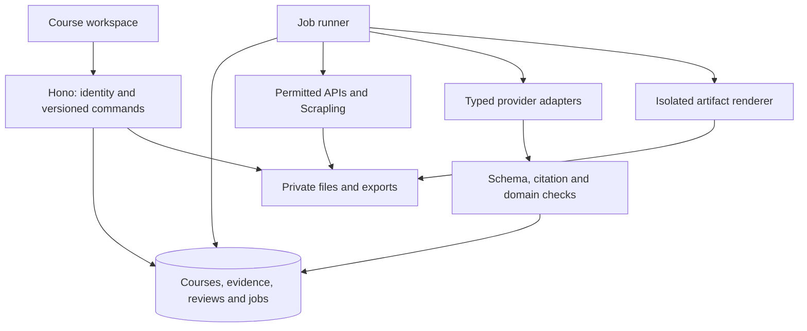

# Lyceum: consolidated improvement and competition plan

**Superseded in direction on 22 October 2026** by [lyceum-upgrade-plan.md](lyceum-upgrade-plan.md): the Lyceum Loop, the design system, the mascots, the maths of the Learn step, the doors and the Amsterdam pitch, demo and video. Sections 1 to 29 below stand as the record of how the product got here; Section 30 and the work-package numbers W00 to W17 remain in use and are cited by the upgrade plan.

Updated **8 October 2026**. Codex is implementing this plan directly at the owner's request after the Claude subscription ended. The handoff in Section 21 remains reusable; it does not require Claude or a paid AI subscription.

**Latest, 14 October 2026.** The organizer's review is recorded in Section 29: the travel fellowship is going ahead, the platform answer given in the room is now work package W14, and W15 to W17 answer the rest of the feedback.

**Friday approval presentation: 9 October 2026, Asia/Kuala_Lumpur. Working length: five minutes.** The final competition date, official rubric descriptors, pilot course, hosting choice and API budget are still undecided. The owner clarified that “TLR” means **Technology Readiness**.

This is the single master improvement plan. It consolidates the earlier audit, implemented improvements, remaining work, product direction, competition strategy, presentation pitch and implementation acceptance criteria. The complete vision remains in scope; the phases make it possible to build and demonstrate it reliably.

Read first:

- [Product and decision boundaries](#1-product-and-decision-boundaries)
- [Judging strategy](#2-how-the-plan-addresses-the-judging-criteria)
- [What works and what remains unfinished](#3-current-state-and-unfinished-work)
- [Implementation work packages](#18-implementation-order-and-work-packages)
- [Friday presentation and speaker script](#19-friday-approval-presentation)
- [Demo and video plan](#20-demo-and-video-plan)
- [Copy-ready Claude handoff](#21-copy-ready-claude-handoff)
- [Independent review checklist](#22-independent-review-and-completion-checklist)
- [The lecturer's research run, 9 October reframe](#24-the-lecturers-research-run)
- [Lyceum inside existing tools](#25-lyceum-inside-the-tools-universities-already-use)
- [Pitch structure: the AWS five V's](#26-pitch-structure-the-aws-five-vs)
- [Market sizing](#27-market-sizing-labelled-estimates)
- [Further improvements](#28-further-improvements-identified-on-9-october)
- [The organizer's review and the platform commitment, 14 October](#29-the-organizers-review-october-2026-and-the-platform-commitment)

## 1. Product and decision boundaries

**Lyceum is a lecturer's course improvement workspace. It helps lecturers inspect evidence, develop course outcomes and topics, prepare teaching materials, and document their decisions within existing university processes.**

The useful output is a reviewed course change or a usable teaching pack. The central question is:

> Why consider this change, what would it affect, can I teach it within my constraints, and what can I take back to my existing workflow?

Industry requirements are one input alongside disciplinary foundations, programme outcomes, student needs, accreditation requirements, academic judgement and available teaching time. A course with little occupational relevance can still have substantial educational value.

### The lecturer remains the decision maker

- Suggestions are drafts. Lecturers can accept, edit, reject or defer each one and record their reasons.
- Lyceum cannot approve an official syllabus, replace an academic board, decide what a university must teach, or certify accreditation.
- Separate **private preparation**, **proposed curriculum revision**, **internal review**, and **institutionally approved curriculum**. Saving a lesson plan does not require a coordinator.
- The institution supplies its review authorities. Avoid imposing one universal “lecturer → management” hierarchy.
- A status such as “reviewed in Lyceum” must not imply institutional approval unless the appropriate human decision and evidence are recorded.
- Formal revisions retain the original version, the candidate, decisions, effective term and audit history. Rejection leaves the active version unchanged.
- External publication and LMS delivery are explicit lecturer actions. Draft generation does not publish anything.

### Cross-university design

Build a configurable institution profile: terminology, academic calendar, teaching hours, credit rules, outcome frameworks, CLO/PLO labels, assessment rules, grading thresholds, templates, language and review roles. Start with neutral defaults and “not supplied” states; do not guess local rules.

Support Malaysian terminology and mappings when supplied, while allowing other frameworks and universities. “Configurable for different institutions” is a defensible product intention. “Compatible with every university” requires evidence we do not yet have.

The adoption path should start with a lecturer's existing syllabus and ordinary files. A university should be able to try one course without migrating its LMS, student records or curriculum approval system.

### Product promise

**Evidence the lecturer can inspect. Changes the lecturer can control. Materials the lecturer can use.**

Keep public course rankings as a later, opt-in research/reporting feature. The first reason to use Lyceum should be better preparation and review, with less repetitive work.

## 2. How the plan addresses the judging criteria

Weights below are supplied by the owner and sum to **100%**. No official competition rubric was found in the repository. `JUDGES.md` is a prototype walkthrough, not proof of the organiser's scoring definitions. Use this matrix now and reconcile it with the official descriptors when available.

| Criterion | Weight | Main argument | Evidence to prepare | What would weaken the entry |
|---|---:|---|---|---|
| Innovation | 30% | Connect inspected evidence to feasible course changes, downstream teaching materials and recorded lecturer decisions. | One trace from an actual excerpt to a reviewed mapping, two constrained alternatives, a lecturer rejection and an affected material. Compare against the current manual process and a generic AI workflow. | Claiming novelty from scraping, agent names or a single unexplained score. |
| Technology Readiness | 20% | Demonstrate a reproducible working workflow and explain its operational limits. | Fresh end-to-end checks, real exported files, source receipts, recovery tests, permission checks and a versioned demo build. Show what is working, experimental and planned. | Treating a polished interface, seeded fixtures or a successful unit test as institutional readiness. |
| Commercial viability | 15% | Offer a low-disruption course-level entry point and a measurable reason for departments to pay. | Interviews, a pilot proposal, measured time/cost per accepted teaching pack, buying process, support assumptions and an integration path. | Invented market size, assumed university partnerships or a subscription model with unknown inference cost. |
| Educational significance | 15% | Improve alignment among outcomes, teaching and assessment while preserving academic judgement and foundational content. | Lecturer-reviewed CLOs, topic hours, assessment rubrics, documented reasons and a small task-based evaluation. | Equating job-ad frequency with educational importance or claiming unmeasured learning gains. |
| Presentation | 10% | Explain one lecturer's problem, demonstrate one useful result, state the evidence and make a clear approval request. | Five-minute script, readable slides, accurate capability labels and answers to likely questions. | Too many disconnected features, jargon or unsupported “world-first” claims. |
| Demo | 10% | Complete a clear task, produce an artifact and show lecturer control. | Stable live path plus a dated screen-recorded backup using the same build and inputs. | A video that implies planned functions already work, hidden fixtures or dependence on a slow paid generation call. |

Innovation plus readiness account for half the marks. Prioritise a working, inspectable course-change workflow over extra animations and a large feature count. Educational usefulness and affordability must appear inside that workflow, rather than only in closing slides.

**Competition thesis to test:** the strongest contribution is maintaining a traceable, constraint-aware relationship between evidence, course decisions and editable teaching artifacts. Establish this with a demonstration and comparative tasks; do not present it as a proven exclusive market capability.

## 3. Current state and unfinished work

### Already implemented in the local prototype

The latest implementation record is **8 October 2026**. Preserve the existing work and the new local course foundation below. This is a browser-local prototype, not a shared institutional deployment.

| Area | Working capability | Limit |
|---|---|---|
| Lecturer Home | Resume the latest teaching plan; course preparation cards; role-specific work queue and notifications. | Uses prototype data and one browser workspace. |
| Courses | Search/filter assigned courses; create an unfamiliar personal course with a title/programme; open it without a proposal. | Personal preparation only; no institutional course publication. |
| Course Studio | Overview, Outcomes & topics, Teaching plan, Proposal, Assessment and History; assigned-course scoping. | Proposed evidence/material workspaces remain planned. |\n| Course revision | CLO/topic add/edit/remove, PLO labels/mappings, achievement evidence, hours, weeks, prerequisite checks, protected topics and diffs. | Rules use lecturer-supplied constraints; no automatic accreditation or teaching-quality claim. |\n| Version decisions | Explicit local adoption/discard with rationale and term; prior outlines, decisions and exports retained. Legacy approval now applies the tested candidate. | Institutional authority remains outside the app; no configurable shared review workflow yet. |
| Teaching plan | Add/edit/remove sessions; week, duration, CLO links, activity, learning check, resources and preparation status; course notes and term label. | One saved plan per course; no separate term archive. |
| Validation | Valid weeks/durations and course-scoped CLO links; ready/delivered sessions require links, activity and a learning check. | “Ready” describes preparation completeness, not pedagogical quality or student mastery. |
| Persistence | Browser saves, unsaved-edit warnings, storage-failure notices, schema-versioned JSON export/import with preview and pre-restore recovery. | No shared database or multi-device sync; original uploaded files are not in backups. |
| Export | Teaching plans, current/candidate/prior course outlines as Markdown; saved workspace and versions as restorable JSON. | No editable slide deck or media generation yet. |
| Guides | Contextual help for all 14 functional sections; searchable Guide & progress with capability and backlog labels. | Update guides as workflows change. |
| Integrity | Fixture notices, evidence edge-case repairs, actual candidate application, stale-check guards, affected teaching/assessment review and uploads kept unverified. Personal courses remain unrated. | Not live evidence, calibrated prediction or server authentication. |
| Accessibility | Better labels, errors, focus, keyboard tabs, responsive navigation, skip link and contrast. | Full WCAG 2.2 AA audit remains pending. |
| Demo protection | Demo/reset actions warn before discarding saved work; normal work pages have fewer demo controls. | Rehearse using a separate browser profile. |

Historical validation on 5 October reached **97 checks**. The 8 October update adds **28 curriculum/recovery/assessment checks**, bringing the total to **125**; the 9 October updates add 24 evidence, collector and research checks, bringing the total to **149**. See Section 30 for the current commands, build, browser checks and inspected artifacts. These checks establish implemented prototype behaviour; they do not establish educational validity, live provider reliability or deployment readiness.

### Still unfinished or materially misleading without qualification

| Gap | Code/document evidence | Required repair |
|---|---|---|
| Fixed market demand and coverage | `src/agents/signal.ts`, `src/data/market.ts` | Compute from an actual frozen evidence set; remove fixture scores from real-course reports. |
| Unverifiable source figures | Market fixtures have names/counts without underlying retrieved postings. | Store original records, short cited excerpts, timestamps, provenance and collection status. |
| Synthetic learner and historical data | `synthetic-cohort.ts`, `historical-backtest.ts`, pinned illustrative learner in `canonical.ts` | Keep examples labelled. Do not present MAE 0.009, 200 learners or the 186-record history as field validation. |
| Draft changes do not drive the forecast | `computeAcceptance()` uses seeded graph/survey/items, not actual candidate wording. | Version the candidate; report unsupported learning effects as unknown. |
| Heuristic predictive parameters | Ability, difficulty and prerequisite penalties are assigned assumptions. | Retain an illustrative sandbox; require real validation before predictive use. |
| Generic authoring output | `runAuthoring()` falls back to the same content across unrelated subjects; live augmentation mostly narrates. | Course-grounded structured drafts that become the actual editable candidate after validation. |
| Incomplete assessment generation | Template items and rounding in `generateTestItems()`. | Real tasks/answers/rubrics, exact mark allocation and infeasibility checks. |
| Institutional verification | Confirmed uploads now remain unverified; syllabus confirmation does not create an official-source badge. | Add separately authorised verification with evidence, identity and date. |
| Shared review authority | Local revision adoption and legacy approval now apply actual candidate CLO/topic edits with preserved baseline and stale guards. | Add institution-configured, authenticated server decisions and concurrency control. |
| Client-only permissions | Prototype role switching and store guards. | Real identity and server-enforced workspace/course permissions before shared use. |
| Incorrect evaluation matching | `latestUploadSince()` and `fillPredictionsForSubject()` rely on upload time. | Match taught version, term, cohort, items and outcome definition. |
| Missing teaching artifacts | PPTX functionality currently parses inputs. | Implement outline/content/review/render/export with editable output. |
| Missing agent integrations | Branded seven-agent design and Scrapling are planned. | Build real tool contracts and logged outputs; labels alone do not implement them. |
| Incomplete data ownership | Validated JSON backups and local versions work; source metadata still lacks durable original files. | Shared storage, validated legacy migration, term archives, retention and deletion. |

The earlier documents remain useful historical context. This plan supersedes requirements to preserve particular scores, pinned learner outcomes or the old fixed demonstration storyline. Do not remove useful functionality merely to hide a limitation; move experimental analytics behind accurate labels.

## 4. The lecturer workflow

```mermaid
flowchart LR
  A[Open a course or lesson] --> B[Confirm material and constraints]
  B --> C[Inspect evidence and mappings]
  C --> D[Choose or draft changes]
  D --> E[Check hours and alignment]
  E --> F[Prepare teaching pack]
  F --> G[Lecturer review and export]
  G --> H[Existing institutional review if required]
  H --> I[Teach and review matched results]
```



These are resumable tasks. Preparing tomorrow's class should not require market research or an institutional review.

| Entry task | Useful flow | Result to take away |
|---|---|---|
| Improve an existing course | Import → confirm → inspect a concern → compare alternatives → edit → review. | A change dossier with before/after wording, rationale, effects and references. |
| Design a course | Set audience, level and constraints → draft CLOs → topics → assessments → check alignment. | A complete editable draft clearly awaiting the university's normal process. |
| Prepare a lesson | Open approved/current course → choose topic and duration → outline → activities/materials → review. | A teaching plan, editable slides, notes and a learning check. |
| Review a colleague's proposal | See exact candidate and evidence → comment → request changes/record decision. | A versioned review record, without retyping the proposal. |
| Refresh a taught course | Clone the previous term → inspect lecturer notes and matched results → select changes. | A new term plan that preserves useful materials and history. |

First-use setup should need only a course title, purpose and supplied document/manual outline. Ask for additional constraints when relevant. A missing PLO framework should allow a private lesson draft but prevent a claim that programme alignment has been checked.

Institution profile and personal preferences should be reusable. Avoid repeatedly asking lecturers for teaching weeks, terminology, language and export styles.

## 5. Useful sections and quality-of-life features

The product should feel complete through coherent work, recoverable state and reusable artifacts. Do not fill empty pages with invented metrics.

The current 14-section guide remains the implementation baseline. The table below describes the target information architecture; consolidate legacy screens gradually and retain useful deep links.

| Section | Main function and useful tools | Help/empty-state message | Priority |
|---|---|---|---|
| My work | Resume work, assigned courses, review requests, recently generated files, actual deadlines entered by users. | “Choose a course or continue your last saved plan.” | P0 preserve; P1 extend |
| Courses | Create/import, search/filter, duplicate a term, archive, restore, export and transfer ownership with permission. | Explain what is saved locally/shared and how to recover it. | P1 |
| Course overview | Course brief, current version, source status, constraints, missing information and next action. | Explain draft versus official/current course status. | P1 |
| Evidence | Source receipts, scope filters, employer/source mix, exclusions, freshness, mapping review and manual evidence. | Offer manual import when no permitted live source exists. | P1 |
| Outcomes & topics | CLO/PLO matrix, topic sequence, hours, prerequisites, before/after diff and alternatives. | Start from the supplied syllabus; offer an editable outline if none exists. | P1 |
| Teaching plan | Session editor, reorder, duplicate week, recurring structure, resource links, notes, delivery reflection. | Show an example entry that is clearly an example. | Existing + P1 |
| Assessments | Blueprint, actual tasks, rubric, answer key, marks/duration checks and reusable question bank. | State which constraints are missing before generation. | P1 |
| Materials / teaching library | Editable decks, worksheets, handouts, diagrams, templates, provenance and stale-content warnings. | Start from a reviewed session outline. | P1 core; P2 media |
| Reviews | Comments anchored to changes, assignments, revision requests, decision reasons and effective term. | Explain the institution's configured decision path. | P1 |
| History | Version comparison, who changed what, restore-as-new-version, export history and term archive. | Never silently replace the original record. | P1 |
| Results & reflection | Matched cohort/term attainment, missingness, lecturer reflections and next-term follow-up. | Explain which comparisons are supported by available data. | P1 later |
| Agents & runs | Role directory, real progress, inputs, outputs, sources, retry/cancel and cost. | Show a useful artifact and execution status instead of simulated thinking. | P1 |
| Settings & integrations | Institution profile, templates, provider capabilities, spend controls, permissions, backup and retention. | Make disconnected capabilities explicit and optional. | P1/P2 |
| Guide & progress | Searchable guidance, role filters, examples, glossary, current limitations and release progress. | “What can I do here, what do I need, and what happens next?” | P0 preserve |

Apply these quality-of-life requirements throughout:

- Autosave with visible “saving/saved/failed” status, unsaved-change protection and recovery after interruption.
- Undo for local edits; undo/restore as a new version for committed work. Confirm destructive changes using the actual object name.
- Reuse last-term plans, templates, accepted terminology and reviewed mappings. Never silently reuse stale evidence.
- Preserve manual edits during generation. Show a preview and let users regenerate only the selected passage, slide or activity.
- Search across courses, CLOs, topics, files and decisions with permissions applied.
- Bulk actions for repetitive work, with a preview of affected items and a reversible path.
- Clear citations, copy/export controls, useful filenames and an artifact download history.
- Explicit long-running job status, cancel, bounded retry, resume and useful error recovery.
- Inline examples and plain-language explanations; advanced statistics and provider settings stay secondary.
- Bilingual content where requested, with institution terminology and a lecturer translation review. Do not infer the teaching language from the university's country.
- Deadline reminders only when a date is entered or integrated. Do not invent due dates to make the Home screen look busy.
- Safe sample workspace, clearly separate from personal data. Reset must not destroy the lecturer's real work.

Guide contract for every section: **purpose → prerequisites → available actions → saved/exported outputs → review boundary → common errors → current limitations → next step**. Keep UI help and `docs/lecturer-guide.md` generated from the same catalogue.

## 6. Innovation that can be defended

Labour-market alignment already exists as a product category. For example, Lightcast describes Skillabi as using programme content and learning outcomes with refreshed market insights. Do not claim that discovering a skills gap is itself a new invention. [Lightcast Skillabi](https://lightcast.io/solutions/software/skillabi).

| Existing approach/category | Proposed Lyceum contribution to test | Comparison task |
|---|---|---|
| Generic AI drafting | Course versions, source-bound suggestions, constraints and reusable structured artifacts. | Give the same brief to both workflows; compare correction effort and traceability. |
| Labour-market intelligence | Turn selected evidence into small, reviewable teaching changes and materials. | Trace one requirement through a course decision and usable lesson output. |
| Curriculum mapping systems | Add current evidence and material dependency updates within a lecturer's preparation workflow. | Change one CLO and identify affected topics, assessments and slides. |
| LMS and office tools | Prepare and export useful content into the existing delivery process. | Move a reviewed pack into the lecturer's current tools without re-entering it. |

This is a differentiation hypothesis, not an exhaustive competitive feature audit. Interview users of existing systems before claiming a missing market capability.

Three demonstrable innovations should anchor the entry:

1. **A decision trail:** exact evidence excerpt → reviewed skill → CLO/topic/assessment → lecturer decision → artifact version. Clicking any result explains where it came from.
2. **Feasible alternatives:** compare a small refresh, balanced revision and larger redesign against the same hours, prerequisites and protected content. “Keep the course unchanged” is a valid option.
3. **Change-aware teaching materials:** editing a CLO or topic identifies affected slides, activities and rubrics. The lecturer updates selected parts, preserving accepted edits.

A fourth, later contribution is a careful follow-up loop using the actual taught version and cohort. It must not depend on unvalidated predictions.

The defensible asset could become permissioned institutional terminology, validated mappings, version histories and workflow evaluation. Scraped text, an LLM subscription and attractive agent avatars are not durable advantages by themselves.

## 7. Scout, Scrapling and credible industry evidence

Scrapling can provide Python fetching, adaptive extraction and browser-assisted collection. Use it inside Scout as a collection tool, with pinned versions and tested source adapters. It does not establish permission to collect a site or guarantee that the result is accurate. [Scrapling repository](https://github.com/d4vinci/Scrapling), [documentation](https://scrapling.readthedocs.io/en/latest/).

### Source order

1. **Manual evidence:** lecturer-supplied job descriptions, permitted exports, industry advisory notes and relevant professional documents. Record supplied provenance separately from independently retrieved evidence.
2. **Permitted employer APIs:** begin with a narrow employer/role scope. Greenhouse documents public job-board GET endpoints; Lever provides a postings API. Confirm intended use and retention for each source. [Greenhouse](https://docs.greenhouse.io/job-board.html), [Lever](https://github.com/lever/postings-api).
3. **Approved employer pages:** add one Scrapling adapter, then expand after inspection. Prefer static fetching, cache, limit concurrency and back off on refusal.
4. **Licensed platforms:** LinkedIn and other restricted job boards require an appropriate authorised route. LinkedIn is not a dependency for the first working version; its agreement restricts scraping. Do not build around copied sessions or access-wall bypass. [LinkedIn User Agreement](https://www.linkedin.com/legal/user-agreement).
5. **Contextual sources:** occupational reports, programme standards, academic/professional guidance and employer panels. Keep different evidence types distinct; a shortage report is not another job-posting count.

For courses with little direct occupational focus, support educational/professional evidence and lecturer rationale without requiring a job-market report. Avoid forcing every discipline into a technology-skills taxonomy.

### Collection and provenance contract

`source policy → collect → retain permitted snapshot/excerpt → parse → scope → deduplicate → extract → review → freeze manifest → calculate`

| Record | Required fields |
|---|---|
| SourcePolicy | Owner/domain, allowed collection method, allowed retention, attribution, refresh interval, policy review date and enabled state. |
| SourceDocument | Original/canonical URL or supplied-file identity, document type, title, source date if known, retrieved/imported time, hash, stored location and access status. |
| JobPosting | Employer, title, geography, seniority, language, posted date or unknown, first/last seen, adapter/version and extraction status. |
| VacancyCluster | Member postings, canonical representative, duplicate/repost rationale and reviewed overrides. |
| SkillMention | Stable skill/taxonomy version, exact short excerpt and locator, required/preferred, explicit/ambiguous and review state. |
| EvidenceSet | Scope, time window, included cluster IDs, exclusions, failures, employer/source mix, frozen hashes and method version. |

One vacancy syndicated across three sites counts once. One skill repeated five times in a posting counts once. Keep original source links. Flag uncertain duplicate matches for review rather than merging different vacancies aggressively.

Do not manufacture posting dates from retrieval dates. Distinguish active listings from newly posted vacancies. A changed description requires a new snapshot/version.

A citation validator must confirm the quoted text exists in the saved source, allowing only documented whitespace normalization. Model-generated links or quotations are not accepted evidence. Where storage rights restrict full snapshots, retain the permitted excerpt and audit metadata and disclose the resulting reproducibility limit.

A report shows its scope, actual records, failures and last successful refresh. A collection failure says “Refresh failed; showing evidence collected on [date].” It never becomes a fresh successful report.

### Collection boundaries

Accept source IDs or validated public URLs. Block local/private/link-local addresses, cloud metadata endpoints, redirects to blocked destinations, unsupported schemes, oversized responses and excessive crawl depth. Revalidate resolved destinations on redirects and requests. Use source-specific rate limits and cancellation.

Treat source content as untrusted data. Instructions embedded in a job page cannot change tool permissions, read credentials or trigger code execution. Scout cannot edit or approve curriculum.

## 8. Mathematical and logical improvements

### Separate four questions

Show **observed requirements**, **documented curriculum coverage**, **teaching feasibility**, and **observed attainment** separately. Each has a different denominator. Do not combine them into one model-generated “relevance” or “employability” percentage.

### 8.1 Observed requirements

Let `J` be eligible unique vacancy clusters in the chosen scope with usable, reviewed extraction. Let `x(j,s)=1` when vacancy `j` explicitly requests skill `s`, otherwise zero after successful review.

`p(s) = sum_j x(j,s) / |J|`

Illustrative calculation only: 18 of 50 eligible reviewed vacancies mention a skill, so observed prevalence is 36%. This is a development fixture, not a finding about current demand.

Always show numerator, denominator, employers, scope, dates and excluded/unknown counts. Separate required and preferred mentions. Failed extraction is unknown; an empty denominator is insufficient evidence.

For uncertainty, implement a Wilson interval with unit tests against known values. Explain that a binomial interval does not repair the selection bias of a convenience sample. Where employers dominate the sample, show an employer-balanced sensitivity view and consider employer-cluster resampling. Do not imply population representativeness from interval width.

For a comparable earlier window:

`change(s) = p_current(s) - p_previous(s)`

Report percentage points and both denominators. Require comparable scope and disclose source mix changes. Otherwise display “Trend unavailable” or “Windows not comparable.”

Source agreement is a descriptive diagnostic. Count distinct sources, disclose syndication and show each direction. No usable evidence yields unknown; an even split says “Sources split.” Agreement is not a probability of truth.

Use configurable publication gates for sample size, employer diversity, missingness and freshness. Establish thresholds with pilot data. Smaller samples can still be inspected with limitations; do not invent universal cutoffs that supposedly ensure validity.

### 8.2 Documented coverage

For every relevant skill, record a lecturer-reviewed stage:

`absent / introduced / practised / assessed / unknown`

Each stage needs cited course evidence. A mention in a syllabus does not establish practice or assessment. “Unknown” is required when the supplied documents are incomplete. A skill can have multiple evidence links.

The lecturer sets a target stage `t(s)` appropriate to the course, level and role. A stage shortfall is an ordinal review aid, not an equal-interval educational measure or mastery probability. Show the stage labels and supporting evidence.

Prioritise using visible dimensions: prevalence, coverage shortfall, prerequisite importance, protected foundations and estimated teaching effort. Let users filter/sort rather than hiding judgement in an arbitrary weighted total.

If a summary is eventually justified, use an explicitly named indicator over reviewed skills with known stages `K`:

`targetCoverage = sum_{s in K} p(s) * I[c(s) >= t(s)] / sum_{s in K} p(s)`

Also report the share of total in-scope demand weight with unknown stages. A zero denominator is unknown; substantial missing weight makes the overall indicator incomplete or withheld under the configured gate. Skill overlap means this is an index over skills, not a share of jobs, students or employability.

Never recommend removing disciplinary foundations merely because employers rarely name them.

### 8.3 Feasibility and alternatives

Represent topic operations as `keep/add/edit/merge/move/remove`. Every candidate declares hours, prerequisites, CLO support, assessment impact and protected content.

Start with deterministic checks:

- Total contact/self-study hours satisfy separately configured limits.
- Required topics and programme outcomes remain supported.
- Topic prerequisites exist, remain supported and contain no invalid cycles.
- Assessment weights total correctly and proposed duration is plausible for review.
- Removing a topic identifies orphaned CLOs, tasks and material dependencies.
- Adding a topic declares where its hours come from; do not silently expand the timetable.

Offer a few feasible alternatives and a “retain current course” option. Compare hours, preparation effort and supported gaps transparently. An optional later optimiser can search feasible combinations; prefer a Pareto comparison to a hidden “best syllabus” score.

Hours are planning estimates. The lecturer confirms feasibility; satisfying an equation alone does not establish teachability.

### 8.4 Assessment logic

Validate weights as finite and non-negative, with the requested total (normally 100%). Reject an invalid or all-zero distribution for a positive mark budget; never silently renormalise it. Distinguish mark allocation from item-count allocation. If integer marks are required, use largest-remainder allocation: floor each quota, then distribute remaining marks by fractional remainder with a stable tie-breaker. Zero-weight categories receive zero.

Example: 7 marks across weights 50%, 30%, 20% gives quotas 3.5, 2.1, 1.4 and final marks **4, 2, 1**, totalling 7. Fixed minimum marks or item counts can make a blueprint infeasible; report the conflict instead of silently changing the request.

Generate actual tasks, answers and marking rubrics. Store marks, duration, CLO mapping and rationale per item. Check Bloom reasoning using task demands, not only an action verb. Generated item difficulty remains uncalibrated.

Edits invalidate affected validation. A valid distribution cannot prove that the questions are accurate or educationally appropriate; retain human review.

### 8.5 Descriptive attainment first

For student `i` and CLO `c`:

`attainment(i,c) = earned marks allocated to c / available marks allocated to c`

Specify rules for missing attempts, exemptions, resits and multi-CLO items before computing. Allocation weights must conserve marks and avoid double counting. Show sample size, missingness, distribution and the share meeting an institution-set threshold.

Self-ratings measure perception and remain separate. Aggregate marks must not be expanded into invented student-level responses.

Retain the current Rasch-style model only as an illustrative sandbox. Its assigned abilities, difficulties and prerequisite penalties are assumptions. Bloom level is not a calibrated difficulty parameter.

Future predictive work needs permissioned response data, held-out terms/courses, baseline comparisons, uncertainty, fit checks and subgroup analysis. Use metrics appropriate to the target: binary probability metrics for binary outcomes, mark/attainment errors for continuous outcomes. Keep model fitting separate from evaluation.

For a curriculum edit without defensible evidence of its effect, display **“Learning impact not estimated.”** A cold-start course can still receive evidence, alignment and constraint checks.

### 8.6 Correct follow-up identity

Freeze an EvaluationPlan with course version, cohort, teaching term, CLO/item versions, outcome definition, baseline, method/model version and evidence manifest.

Only matching results may evaluate that plan. Upload time is not teaching time. Reject wrong-term, wrong-course and incompatible assessment comparisons with an explanation. Keep signed residual and absolute error separate.

Observed changes can be reported. Do not describe them as caused by Lyceum without an appropriate study design.

## 9. Course design and human review

Use structured, versioned objects instead of treating generated paragraphs as the entire course model.

| Artifact | Minimum content |
|---|---|
| CourseBrief | Level, audience, prerequisites, credits, contact/self-study hours, weeks, language, PLOs, constraints and evidence scope. |
| CLOVersion | Stable course-scoped identity, wording, observable action/context, achievement evidence, Bloom rationale and framework mappings. |
| Topic | Sequence, hours, objectives, prerequisites, references and material links. |
| Assessment | Blueprint, items, answers, rubric, marks, duration and allocated CLO evidence. |
| ChangeSet | Baseline/candidate IDs, operations, reasons, citations, impacts, author, checks and review state. |
| LessonPlan | Objectives, timing, activities, worked examples, checks, resources and lecturer notes. |
| MaterialVersion | Source course/topic versions, content blocks, artifact location, provenance, review and stale state. |

Manual CLO/topic editing must work without an AI provider. AI suggestions use the same validation and review path as human edits.

Import states: `uploaded → parsed → lecturer-reviewed`; institutional verification is a separate attestation with actor, authority and supporting record. Display extracted text beside the proposed fields and retain page/slide/cell locators.

Suggested review flow:

`draft → ready-for-review → changes-requested / reviewed → authorised decision recorded → effective version`

Configure the institution's actual process. If an external committee is the authority, export the dossier and allow its documented decision to be recorded later. Do not auto-activate a syllabus merely because a local reviewer clicked a generic button.

Approval checks permissions, draft revision and validation revision, then writes the version and audit event atomically. Repeated requests are idempotent. Concurrent edits invalidate stale review; rejection preserves the current version.

## 10. Distinct, branded agents with real work

Use “Lyceum agents” as a product label, accompanied by plain role descriptions. A specialised assistant or deterministic service can fit the branded workflow without claiming independent autonomy.

| Identity | Inputs and tools | Artifact and boundary |
|---|---|---|
| **Folio** (Course reader) | Supplied documents, parsers, structured extraction. | Reviewed course record with locators; cannot declare a document official. |
| **Scout** (Industry researcher) | Source registry, permitted APIs, Scrapling, requirement extraction. | Evidence manifest and cited requirements; cannot change curriculum. |
| **Atlas** (Curriculum mapper) | Reviewed course/evidence, semantic matching, graph checks. | Proposed coverage/PLO mappings and impacts; lecturer confirms them. |
| **Quill** (Course designer) | Course brief, constraints and selected evidence. | CLO/topic alternatives, assessments and lesson drafts; never self-approves. |
| **Prism** (Teaching-material creator) | Reviewed outline, templates, renderers and optional media APIs. | Editable deck/handout/media assets; no automatic publishing. |
| **Lens** (Evidence analyst) | Frozen evidence and correctly matched results. | Deterministic descriptive reports, limitations and research scenarios. |
| **Steward** (Review assistant) | Exact candidate, sources, validator results and review policy. | Review dossier and unsupported-claim checks; cannot substitute for the human decision. |

Migration: Intake → Folio; Signal → Scout; Curriculum → Atlas; Authoring → Quill; new Prism; Cohort + Analogy → Lens; Evaluator → Steward. Keep old internal IDs compatible until a tested migration exists. Proposed names need availability review before public branding.

Every run records objective, input versions/hashes, actual tools, provider/model or template identity, output artifacts, source IDs, validators, time, usage/cost and status. Use `queued/running/waiting-for-review/completed/failed/cancelled`.

Show concise actions and explanations; do not fabricate private reasoning, “agent conversations” or activity. A replay is labelled with its original run date. Decorative views should reflect real events and respect reduced motion.

Give all seven roles a common typed AgentRunner contract for inputs, tools, outputs, review state and run records. Use SDK tool loops where they add value, such as bounded artifact generation/render/repair. Use structured calls for drafting and ordinary code for calculation and rules. Seven brands do not require seven services, seven model calls per action or seven separate subscriptions.

Steward critique supplements objective checks and lecturer judgement. Another model agreeing with a draft does not independently validate it.

## 11. Teaching materials, Gemini images and video

### Core teaching pack

First implement: reviewed lesson outline → structured slide content → deterministic template rendering → visual/content review → editable export.

A pack should include editable slides, speaker notes, learning objectives, an activity, a worked example where appropriate, a learning check, references and optional handout/rubric. Let the lecturer choose duration, language, student level and style.

Prefer a maintained PPTX renderer evaluated in a short spike. Layout belongs to renderer code; the model supplies structured content. Test PowerPoint/LibreOffice opening, text editability, font fallback, notes, overflow, citations, reading order and text alternatives. Render every slide for inspection. Do not call a full-slide bitmap an editable deck.

Importing an existing deck should begin with extraction and a proposed revision, not a promise of perfect arbitrary template preservation. Support selected institutional templates first and document fidelity limits.

Regenerate selected slides or blocks. Preserve locked lecturer edits and flag conflicts. A changed source CLO/topic marks dependent materials stale; it does not silently rewrite them.

### Gemini feasibility and scope

**Yes: Gemini API integration can support image generation/editing, and Google's video API supports video generation.** Treat these as optional Prism capabilities behind capability checks and budgets. Current official documentation describes native image generation and video model options; availability depends on the configured account/model. [Image generation](https://ai.google.dev/gemini-api/docs/image-generation), [video generation](https://ai.google.dev/gemini-api/docs/video).

| Output | Proposed implementation | Review and fallback |
|---|---|---|
| Teaching illustration | Generate/edit an image from a reviewed learning objective and visual brief. | Lecturer checks factual meaning, misleading details and suitability; use a supplied/licensed image if unavailable. |
| Infographic | Verified structured facts → editable chart/text layout → optional generated illustration. | Numbers, labels and sources remain editable and independently checked. Avoid baking critical text into a generated image. |
| Poster | Template-based title, figures, citations, institution identity and optional illustration. | Export print-ready PDF plus editable source; review dimensions, contrast and references. |
| Short concept video | Approved storyboard → explicitly requested clips → review → assembly with captions/transcript. | Lecturer checks each scene and narration; fall back to a narrated slide recording. |
| Lecture recap | Approved outline/slides → script → optional narration/captions and recording. | Review language, pronunciation and accuracy before export. |
| Competition demo video | Screen recording of the real app with voiceover and captions. | Use genuine app output. Generated scenes cannot stand in for functionality evidence. |

Video is P2, after useful slides and evidence. It adds expense, waiting and review effort; it should not consume the Friday implementation window.

For media jobs, retain prompt, provider/model, source inputs, generated-asset metadata, review decision, usage and rights/provenance information. Preserve provider provenance metadata where supplied. Offer meaningful alternative text and equivalent non-video content.

Use configurable model IDs and capability discovery/smoke tests; avoid embedding a transient model name throughout the app. Use the official Google SDK/API and validate the installed version against current documentation. Keys belong on the server.

### Cost example and controls

At the checked price on 7 October 2026, the Gemini pricing page lists Veo 3.1 Fast video with audio at **USD 0.10 per second for 720p**. Twenty successful eight-second clips would therefore cost **USD 16** for generation alone, before other services, additional successful attempts and taxes. This is an illustrative calculation, not the user's budget or a quotation. Recheck pricing and model access before implementation. [Gemini API pricing](https://ai.google.dev/gemini-api/docs/pricing).

Before paid generation, show the expected cost range and configured allowance. Reserve budget atomically for in-flight jobs, bound output length/retries, reconcile actual usage and stop when the allowance is exhausted. Cancellation may not reverse a provider charge already incurred.

Default media generation to disabled until credentials and a budget are configured. Permit manual uploads and ordinary editable diagrams without any media API.

## 12. UI quality and accessibility

Design around a course document/editor with an optional evidence side panel. Persistent context should show course, version, term and draft/review state. Tables suit evidence and mappings; diffs suit changes; thumbnails suit teaching materials.

Use restrained typography, readable secondary text, consistent forms, purposeful spacing and visible save/error feedback. Prioritise real content density and useful next actions. Avoid excessive badges, score rings, empty dashboards and compulsory agent animation.

Target **WCAG 2.2 AA** across complete workflows: keyboard access, semantic structure, labels/error associations, visible and unobscured focus, dialog focus management, status announcements, colour-independent meaning, reflow, accessible authentication and alternatives to dragging. WCAG generally requires 4.5:1 normal-text contrast, 3:1 large text, and minimum pointer targets of 24 CSS pixels with defined exceptions; prefer comfortable 44-pixel targets when practical. [WCAG 2.2](https://www.w3.org/TR/WCAG22/).

Acceptance includes automated axe checks plus keyboard-only and NVDA testing, 200% text resizing, 400% zoom/reflow at equivalent 320 CSS pixels, reduced motion, contrast checks, long content and failed/retry states. Audit exported materials as well as the web UI. Automated checks alone do not establish conformance.

Maintain an issue register with severity, reproduction, affected journey and retest. No critical task-blocking accessibility issue may remain on the demonstrated path. Say “designed and tested toward WCAG 2.2 AA” until the complete conformance scope has actually been assessed.

## 13. Using existing subscriptions and agent SDKs

Use the owner's ChatGPT, Claude Code and Gemini subscriptions immediately for development, critique, drafting and manual experiments through their supported interfaces. Account tiers and eligibility have not been verified.

| Route | Recommended use | Important distinction |
|---|---|---|
| Claude Code / Claude Agent SDK | Claude implements work packages; a bounded SDK experiment may help with artifact tasks. | Anthropic's current help-page update says the announced credit changes were paused and SDK/`claude -p` usage still draws from subscription limits. Do not rely on the superseded credit table below that notice. [Current plan update](https://support.claude.com/en/articles/15036540-use-the-claude-agent-sdk-with-your-claude-plan). |
| ChatGPT / Codex | Independent review, tests, research and local supported development workflows. | Codex distinguishes subscription sign-in from separately billed API-key use. The Codex SDK offers programmatic local-agent control. [Authentication](https://learn.chatgpt.com/docs/auth), [Codex SDK](https://learn.chatgpt.com/docs/codex-sdk). |
| ChatGPT-connected app experiments | Investigate a supported personal/local integration only after checking eligibility. | Current app-server guidance excludes commercial/hosted use of that authentication route. Do not turn a local account session into the shared Lyceum backend. [App-server guidance](https://learn.chatgpt.com/docs/app-server). |
| Gemini / Google AI subscription | Manual visual/storyboard experiments and development through available account tools. | Verify Gemini API project billing, model access and quota separately. API billing uses Cloud Billing; the subscription alone does not establish the project's API allowance. [API billing](https://ai.google.dev/gemini-api/docs/billing). |
| Explicit API provider | Shared application inference with its own credentials, limits and audit record. | Configure separately and measure actual cost. Never pool personal browser sessions or copy login tokens into the server. |

Provider rules change. Recheck official authentication and product terms when implementing an adapter. Do not change the repository licence just to qualify for an integration.

Start with **one text provider** behind a typed interface. The repository already uses `@anthropic-ai/sdk`, making it a practical first integration to evaluate. Add Gemini media or another text provider only for a demonstrated capability, quality or cost benefit.

Capabilities should include structured drafting, document input, tool use, image generation and video generation separately. A provider may support only some. Return real timeout/quota/schema errors rather than a successful-looking fixture.

Low-cost bridge: export a course brief, selected evidence and a structured response template for use in the owner's existing AI app; import the response into Lyceum for schema, citation and lecturer review. Label this **manual AI handoff**. It preserves a useful workflow while direct integration is developed.

## 14. Architecture and data ownership

Keep React, TypeScript, Vite and Hono. Refactor incrementally. Preserve existing work and avoid a framework rewrite.

Friday's demo can use the current local prototype. The shared pilot target is one Hono service, PostgreSQL, a modest durable jobs table and private artifact storage. Local development can run these on the existing machine. Add the Python Scout worker only when a real adapter is implemented; no separate queue platform or container cluster is required initially.



Core records: Workspace, Membership, InstitutionProfile, Course, CourseVersion, CLO, PLO, Topic, Assessment, LessonPlan, MaterialVersion, SourcePolicy, SourceDocument, JobPosting, VacancyCluster, Skill, SkillMention, SkillMapping, EvidenceSet, ChangeSet, ReviewDecision, AgentRun, EvaluationPlan and ResultUpload.

Stable IDs must be course/workspace scoped. Bare “CLO1” is a display label, not a global identifier.

Use domain commands for import confirmation, draft edits, evidence freezing, review decisions, version activation and exports. Every mutation validates identity, workspace/course access, payload and expected revision on the server. Approval/version/audit writes belong in one transaction.

Long jobs need idempotency keys, input versions, bounded retries, timeout, cancellation and resumable status. An edited input either creates a new job or explicitly invalidates the previous output. Never attach an old artifact to a new course version silently.

Before any shared deployment: real authentication, server permissions, cross-workspace isolation, controlled CORS, size limits before full buffering, bounded PDF/archive extraction, secret handling, transport encryption, retention/deletion controls and tested backup restore. Keep public reports separate from student data and unpublished course material.

Default provider payloads to the minimum necessary. Prefer aggregated or pseudonymised results; private student records are unnecessary for the evidence-to-lesson demonstration. Record what was sent to which provider without logging secrets or private model reasoning.

Export the browser workspace before migration and validate imports against a versioned schema. Keep a recovery copy and explicit reconciliation. Browser storage remains useful for preferences/recoverable drafts, but must not masquerade as institutional persistence.

## 15. Integration without replacing university systems

Use a staged approach. A connector's presence does not establish compatibility with every installation.

| Stage | Integration | Value and boundary |
|---|---|---|
| First | Files: syllabus input; Markdown now; planned DOCX/PDF/PPTX and CSV exports. | Lecturer keeps ordinary office/LMS workflows. Validate each supported format; do not claim every import already exists. |
| First | Institution templates and configurable framework mappings. | Match local forms and terminology without prescribing policy. |
| Next | Google Slides. | The official API supports reading/writing presentations. Add explicit OAuth access to selected outputs after the local PPTX pipeline works. [Slides API](https://developers.google.com/workspace/slides/api/reference/rest). |
| Next | Selected Drive/OneDrive/SharePoint file handoff. | Implement only the connector needed by a pilot, after a permission/API spike. Start with selected files and explicit save/export. |
| Later | LMS launch and content links through LTI 1.3 / Deep Linking. | Standards offer a route for tool launch and resource selection; test the actual LMS and administrator configuration. Grade/roster services are separate scope. [1EdTech implementation guide](https://standards.1edtech.org/lti/guides/implementation_guide/implementation-guide). |
| Later | Existing university identity provider. | Reuse institutional identity where supported; map local roles and course permissions deliberately. |
| Later | SIS, curriculum committee systems or specialist assessment exports. | Require a documented pilot need and a supported interface. Do not make these a prerequisite for initial lecturer value. |

Avoid blanket claims of LMS certification. File export can be the successful integration for an early pilot. Directly editing an official system needs scoped permissions, preview, explicit action and an audit trail.

Define connector contracts for capability, authentication, selected scope, mapping, status, revocation and retry. Disconnecting a provider must leave locally owned course artifacts usable.

Prove portability with two different institution profiles and at least two subject areas. Use clearly labelled synthetic/openly permitted course fixtures until real course owners participate. Framework mappings require review by the relevant institution; configuration is not accreditation.

## 16. Commercial viability and low-cost adoption

### Customer and adoption hypothesis

- **Daily user:** lecturer/course team preparing and reviewing teaching.
- **Champion:** programme coordinator, teaching innovation unit or curriculum lead.
- **Potential buyer:** department/faculty/central teaching unit, depending on local procurement.
- **Beneficiaries:** lecturers, reviewers and students; students need not be direct users of the first release.
- **Initial purchase reason to test:** reduce preparation/review effort while improving traceability and producing useful files.

Start with a lecturer-owned course and a voluntary department pilot. Seek a small workflow commitment before an institution-wide rollout. Do not claim university partnerships, willingness to pay or market size until documented.

### Product packaging to test

| Offer | Scope | Commercial question |
|---|---|---|
| Personal/local evaluation | Manual course preparation, file export and optional manual AI handoff. | Does the workflow create enough value to be used again? |
| Department pilot | Shared course versions, review, reusable templates, limited AI allowance and onboarding. | Will a department pay for repeatable preparation/review value? |
| Institution service | Identity integration, governance configuration, support and contractual data controls. | Does the value justify procurement, integration and support costs? |
| Optional media allowance | Images/video separated from ordinary text/document usage. | Will users pay for this after seeing cheaper alternatives? |

Do not promise unlimited AI in a low-priced subscription. Pricing is an experiment after costs and buyer interviews; no price or revenue projection in this plan is validated.

Build a bottom-up commercial model using named assumptions: reachable departments × plausible adoption × courses/users per department × tested price. Label every unmeasured input. Include sales cycle, onboarding and support; software hosting alone is not total cost.

### Start cheaply

For Friday, use the existing machine, local prototype and existing subscriptions through supported interfaces. This can avoid new hosting/API purchases for that demonstration, but development time and existing subscriptions still have costs.

For the first full workflow, use narrow source scope, cached evidence, one text provider, deterministic calculations and file export. Add shared hosting only for the actual pilot. Keep video disabled by default.

Track:

`costPerAcceptedPack = (text + image + video + collection + storage + hosting + allocatedSupport) / acceptedPacks`

Include failed/retried runs where charged. If there are no accepted packs, report raw costs and “not yet measurable.” Separate variable cost from fixed engineering and operational cost.

Set per-job, per-user and workspace spending limits; reserve concurrent job budgets and reconcile usage. Cache by relevant input/version hashes. Cheap extraction models and stronger drafting models are options to evaluate, not assumed quality guarantees.

Proposed discovery work: interview 8 to 12 lecturers/coordinators across at least two disciplines and ask about their current process, files, constraints, authority, willingness to pilot and who can buy. These are targets, not completed interviews. Record consent for any quote used publicly.

The commercial proof for judges should eventually be: actual workflow baseline, repeated use, a concrete pilot commitment, measured cost and a credible route to purchase.

## 17. Educational evaluation and technology readiness

### Current readiness statement

**Working local prototype with tested lecturer-planning components; the integrated live evidence, course revision and editable-material workflow is still being built. No institutional pilot or calibrated learning-impact evaluation is established in the reviewed repository.**

Technology Readiness is 20% of the supplied rubric; that does not automatically mean the organiser requires a formal numeric TRL. NASA's definitions distinguish proof of concept, laboratory validation and demonstration in a relevant environment, including software considerations. Use them as an external reference if a TRL explanation is requested, not as the organiser's rubric or a certification. [NASA TRL definitions](https://www.nasa.gov/pdf/458490main_TRL_Definitions.pdf).

Do not assign the whole envisioned system a high TRL because some components work. Assess the actual claimed system, dependencies and evidence. A lecturer pilot is still a target until it occurs.

| Readiness gate | Required evidence | Current position |
|---|---|---|
| Reproducible local workflow | Fresh install/start instructions, tested course-plan flow and real download. | Components previously checked; rehearse the exact Friday build. |
| Integrated advisory prototype | Actual source receipts → reviewed mapping → course change → valid version → editable teaching pack. | Incomplete. |
| Relevant user pilot | Lecturers use their own permitted courses with actual constraints; record issues and outcomes. | Planned. |
| Shared operational pilot | Server permissions, isolation, recovery, spend limits, support and approved data handling. | Planned. |
| Educational impact claim | Appropriate longitudinal/comparative evaluation with uncertainty and confounders addressed. | Research track. |

### Pilot design

Proposed first study: **3 to 5 lecturers, at least two disciplines and three course examples**, adjusted when participants are known. It is a usability/quality pilot, not sufficient evidence of learning gains.

Use comparable tasks: revise one outcome/topic package and prepare one lesson pack. Compare the lecturer's ordinary process with Lyceum; optionally include a generic AI-assisted condition. Counterbalance task order where practical and record prior familiarity. Do not compare a polished Lyceum example against an intentionally poor baseline.

Collect:

| Measure | Method | Initial gate or interpretation |
|---|---|---|
| Task completion | Can the lecturer finish and export without coaching? | Record successes and failure reasons, not only satisfaction. |
| Time and rework | Time to accepted result; number/type of corrections. | Look for useful improvement; do not promise a percentage before measurement. |
| Citation fidelity | Manually check a declared sample against stored excerpts. | Zero fabricated citations in the demo; report sample size and observed rate in the pilot. |
| Extraction quality | Human-labelled skill mentions and duplicates, with disagreements adjudicated. | Precision/recall plus error examples; labels and data split documented. |
| Educational alignment | Lecturer/expert rubric for assessability, topic support, assessment fit and level. | Record rubric and reviewer differences. |
| Lecturer agency | Can users reject, override, restore and explain a decision? | Core actions must work without accepting an AI suggestion. |
| Constraints | Hours, prerequisites and protected content before/after. | No silent violation in an accepted package. |
| Accessibility | Complete task with keyboard/assistive technology; audit failures. | No unresolved critical barrier on the release path. |
| Practical value | Reuse next week/term, review effort, usefulness of files. | Repeated use is stronger evidence than a one-time positive reaction. |
| Economics | Actual run/pack cost and support time. | Must fit a consciously selected pilot allowance. |

Keep interview evidence, measured task data, synthetic tests and product hypotheses in separate categories. Consent and anonymisation are required for identifiable pilot feedback used in a presentation.

## 18. Implementation order and work packages

Priority meanings:

- **P0:** Friday approval readiness, honest claims and reliable existing workflow.
- **P1:** The complete evidence-to-course-to-teaching-pack workflow and pilot essentials.
- **P2:** Media, selected integrations, collaboration refinements and expansion.
- **P3:** Validated predictive research and optional public reporting.

The full vision is retained. Friday is an approval milestone, not a promise to finish the platform in two days. Work estimates below are rough active effort for one developer with coding assistance and must be revised after each package.

### W00: Record the baseline and protect existing work [P0]

Status: [x] completed for the 8 October local implementation baseline; see Section 30.

Read the repository and this plan. Inspect `git status`; preserve all existing modified/untracked work. Run the relevant current checks and record exact results. Establish working/current/planned labels and choose the tested demo build.

Acceptance: existing course-plan save/reload/export works; no new unsupported claim; no secrets in output; limitations and test dates are accurate. Do not reset the workspace or discard user data.

### W01: Prepare Friday's path and recovery [P0]

Status: **partial**. Local recovery, guides and tested browser path implemented on 8 October; the self-driving demo was replaced on 9 October with the research-run storyline (Section 20). The six-slide deck, 75-second recording and Friday rehearsal have not been produced.

Dependencies: W00. Focus on small verified fixes, presentation readiness and guidance.

Use the existing course workspace. Make labels and help consistent; verify the export and storage-failure state. Prepare the six-slide content and a real screen recording using Sections 19 and 20. Keep sample work separate.

If safe within the window, add schema-versioned JSON workspace export/import with preview, validation and a pre-import recovery copy. This is useful but must not displace a functioning demo. Never label the current Markdown export a backup.

Acceptance: one complete 75-second path and recorded fallback; actual files open; sample-data labels visible; presenter can state exactly what remains planned. Freeze risky changes before rehearsal.

### W02: Persistent course foundation and identity [P1, roughly 1 to 2 weeks]

Status: **partial local foundation**. Unfamiliar personal course creation, typed definitions/versions, browser persistence and JSON recovery work. Shared identity/storage, institution profiles, server permissions and term archives remain pending.

Dependencies: W00. Main areas: `server/`, `src/types.ts`, `src/app/store.ts`, new domain/repository modules and migrations.

Implement institution profile, memberships, course versions, term plans and source files. Add real authentication and server-side course/workspace permissions. Import local prototype data through a validated migration with backup and counts. Keep a local sample mode separate.

Acceptance: create an unfamiliar course, persist/reload it, archive a term, restore a backup and reject direct wrong-course/wrong-workspace requests. The app must not depend on seeded course IDs.

### W03: Manual curriculum editor and real review [P1, roughly 1 to 2 weeks]

Status: **local editor implemented; package partial**. CRUD, PLO mappings, constraints, protected topics, diffs, local adoption/discard, baseline preservation, stale-review protection and upload verification repair work. Institution-configured server review remains dependent on W02. This local slice was implemented ahead of the shared foundation so lecturers can already do useful manual work.

Dependencies: W02. Main areas: Studio/CourseWorkspace, domain commands, version/review endpoints.

Implement full CLO/topic CRUD, PLO mappings, hours, protected content, prerequisites, change diffs and configurable review authority. Repair upload verification states and approval application.

Acceptance: add/edit/remove a CLO/topic, see affected dependencies, reject one change, revise another, record an authorised decision and activate the correct candidate. Stale/duplicate approvals are handled safely. Old versions remain inspectable.

### W04: Real evidence with Scout [P1, roughly 1 to 2 weeks]

Status: **manual path and two permitted board APIs implemented on 9 October**. Lecturer-supplied receipts, on-request collection from the Greenhouse and Lever board APIs through the local API (cached, rate limited, host allow-list), a dated saved sample, lexicon-assisted scanning with exact quotations, fingerprint duplicate detection, reviewed denominators and meeting briefs work in Course Studio. The Scrapling adapter, snapshots of arbitrary sites, cross-site vacancy clustering, scheduled refresh and refresh-failure reporting remain pending. See Section 24.

Dependencies: W02; source access confirmed per adapter. Main areas: new evidence domain/server modules, Python worker, replacement path for market fixtures.

Build manual import first, one permitted employer API next, then one approved Scrapling page adapter. Add source policies, snapshots/excerpts, deduplication, skills and frozen manifests. Broad job-board coverage is not a gate.

Acceptance: every displayed requirement opens its receipt; duplicates count once; ambiguous/extraction-failed records remain visible; refresh failure preserves the true collection date; private-network URL tests fail safely.

If a live source is unavailable, complete manual evidence and the adapter's permitted saved-fixture tests. Report the live integration as unverified.

### W05: Evidence calculations and constraint engine [P1, roughly 3 to 7 days]

Status: **partial on 9 October**. Observed shares with explicit numerators and denominators, 95% Wilson intervals, required against preferred counts, reviewed coverage stages, the demand-weighted target coverage index with its unknown weight, and the unknown state for empty evidence work; the 18 of 50 example is a unit test. Comparable time windows, employer-balanced views, publication gates and the feasibility optimiser remain pending. Topic constraint checks were delivered under W03.

Dependencies: W03/W04 data contracts. Main areas: `src/agents/signal.ts`, `src/data/market.ts`, `src/lib/` domain calculations.

Implement Section 8: counts, denominators, unknown states, comparability, coverage rubric, uncertainty and feasibility. Retain fixture calculations only in the labelled sample/research path.

Acceptance: empty evidence is unknown; repeated postings/mentions do not inflate counts; arbitrary new skills work; changed evidence changes the result; example 18/50 is 36%; unknown coverage is disclosed; constrained alternatives do not add hidden hours.

### W06: Structured generation and agent identities [P1, roughly 1 week]

Dependencies: W03/W05. Main areas: `src/agents/`, provider endpoints/adapters, run UI.

Introduce typed provider capabilities and schema-validated course-grounded output. Migrate branded display names compatibly. Preserve manual edits and record actual provenance, cost and status. Use SDK tool loops only for bounded tasks that benefit.

Acceptance: two unrelated subjects receive appropriate different drafts; invalid citations/malformed output cannot become accepted artifacts; timeout/cancel/quota errors are honest; the manual workflow remains usable with no provider.

### W07: Useful assessment generation [P1, roughly 3 to 7 days]

Dependencies: W03/W06. Replace store-level template generation with domain logic.

Implement blueprint constraints, exact marks, actual tasks, model answers, rubric, question review and selective regeneration.

Acceptance: 7 marks at 50/30/20 allocates 4/2/1; zero/negative/infeasible inputs handled correctly; total marks conserved; edited items trigger fresh checks; tasks reviewed for correctness and alignment.

### W08: Editable teaching packs with Prism [P1, roughly 1 to 2 weeks]

Status: **first step implemented on 9 October**. Deterministic template rendering of editable PPTX teaching packs from saved sessions, outcomes and evidence receipts, and of the meeting brief as slides, with speaker notes and no model-written text; the proofs and smokes unzip the generated files and read the slides. Outline review with model drafting, selective regeneration, institutional templates, handouts and accessibility checks of exported decks remain pending.

Dependencies: W03/W06. Main areas: new lesson/material domain, renderer and course Materials UI.

Implement outline review, structured content, selected templates, editable PPTX, notes, references and rendered preview. Add stale dependencies and protected manual edits. PDF/handout follows the core deck.

Acceptance: an unfamiliar reviewed topic produces a useful file that opens in the target presentation application; text remains editable; every slide is visually inspected; selected regeneration preserves accepted content. No synthetic screenshot substitutes for a real export.

### W09: Matched results and lecturer reflection [P1, roughly 1 week]

Dependencies: W03; real/permitted result format required for pilot. Main areas: result upload, evaluation identities, descriptive analytics.

Implement explicit term/cohort/version matching, attainment definitions, missingness and reflection. Isolate unsupported predictive claims.

Acceptance: late-uploaded old-term results cannot score a newer plan; multi-CLO allocation conserves marks; aggregates remain aggregates; missing data and unsupported effect estimates remain unknown.

### W10: Complete journeys, accessibility and recovery [P1, throughout]

Dependencies: each affected package. Main areas: shared primitives/tokens, all course screens, help catalogue and browser checks.

Implement Section 5 and Section 12 across actual tasks, including long documents, empty/error states, responsive layout, keyboard use, provider failure and interrupted saves.

Acceptance: complete keyboard and screen-reader journey, no critical barriers, tested 320-pixel reflow, useful recovery and synchronised guides. Record remaining issues; do not claim conformance from a token/colour change.

### W11: Pilot and selected integration [P1/P2, roughly 1 to 2 weeks plus user availability]

Dependencies: W02 to W10 relevant to the claimed workflow.

Conduct the pilot, benchmark costs, test a restore, collect feedback and implement the one integration the pilot actually needs. Prepare deployment/operations instructions before shared use.

Acceptance: documented user tasks and limitations, course-owned artifacts, no cross-workspace access, measured cost and an agreed support/retention process. Update competition claims from actual evidence.

### W12: Optional visuals, posters and video [P2, roughly 1 to 2 weeks after core packs]

Dependencies: W08, provider capability check and configured spend limits.

Implement Gemini media adapters, editable infographic/poster composition, storyboard review, caption/transcript support and per-job budgeting.

Acceptance: user can inspect inputs/cost, cancel or recover a job, review the asset and use a non-generated alternative. Facts and critical labels remain checked/editable. No paid call happens merely by opening the page.

### W13: Research and expansion [P3, data-dependent]

Validated predictive models, evidence watchlists, cross-course impact analysis, faculty terminology/mapping memory, wider integrations and optional public reports.

Acceptance: each new claim has a relevant evaluation. Public comparative reporting requires adequate coverage, correction procedures and institution consent; predictive release requires meaningful held-out performance over a baseline.

### W14: The ecosystem layer: an MCP server, then Microsoft 365, Google and LMS doors [P1 after W02, roughly 3 to 5 weeks for the first door]

Recorded 14 October 2026 after the organizer's review (Section 29). Dependencies: W02 (shared API, identity, server-side permissions), the OpenAPI description in Section 28 item 8, and a pilot institution's actual stack.

Implement in this order:

1. The OpenAPI 3.1 description of the operations every door needs: collect on request, list sources with receipts, evidence report, prepare brief, send brief, course outline, teaching pack, quiz items, record a decision.
2. A remote MCP server over that API. Read-only tools are annotated read-only (evidence report, course outline, sources with receipts). Drafting tools return drafts for review (brief, teaching pack, quiz items). No tool confirms a quotation, adopts a revision or sends a brief without an explicit human confirmation. Streamable HTTP transport, OAuth per the MCP authorization specification, scopes per tenant and per course.
3. The host package for the pilot's stack only. Microsoft: a Copilot Studio agent or a declarative agent from the Microsoft 365 Agents Toolkit, Entra ID sign-in, briefs posted to a Teams channel as Adaptive Cards that link back to the receipts. Google: Gemini connected to the MCP server where the tenant allows it, a Workspace add-on for save and send, Slides and Docs export. Build the second door when a second institution needs it.
4. LMS: LTI 1.3 launch and Deep Linking for teaching packs, quizzes exported as QTI and Moodle XML, marks imported from a gradebook CSV into W09.
5. Audit and tenancy: every tool call logged with caller, host, tool and the record IDs it touched; tenants isolated; revoking a host leaves the workspace and its exports intact.

Acceptance: from inside the pilot's AI assistant, a lecturer gets a course's evidence report with receipts and escalates a brief to a coordinator without opening the web app, and the coordinator receives it in Teams or Gmail with a link to the receipts. Every quotation shown in a host matches its stored source text. A host cannot confirm, adopt or send without an explicit human action, and read-only tools change nothing, both under test. Disconnecting the host leaves the workspace working, and one tenant's records never appear in another. Competition and sales claims change only after the pilot tenant passes; until then the doors are "planned".

Risks: MCP support is new and differs by host, plan, licence and admin setting, so each host is re-verified at pilot time. Copilot Studio needs a licence or trial and admin approval. Declarative agents reportedly cache tool lists, so tool changes need republishing. The Workspace connectors launched read-only for listed partners. Any personal data falls under Malaysia's PDPA 2010 and the pilot institution's policies.

### W15: Living personas and visual guidance [P1, roughly 1 to 2 weeks]

Recorded 14 October 2026 after the organizer's review. Dependencies: the identities in Section 10, the Gemini asset brief, and W16 for the order.

Implement:

- Mascot art for the seven agents in one style (prompts in `docs/history/presentation/gemini-asset-brief.md`), each with its name, a one-line personality tied to its job, and moods driven only by real records: resting, working while a real request runs, waiting for you when a proposal awaits confirmation, done when the result is saved, stuck on an error with the recovery step. No animation without a running request, and reduced motion respected.
- Agents appear where they work: Scout beside collection, Lens beside the chart, Steward beside the brief, Quill in the revision editor, Prism beside the packs, Folio on the course overview, Atlas beside the mapping.
- Gamification that rewards evidence quality and completion, never volume or speed: journey milestones (first verified quotation, first reviewed set, first brief sent, first refreshed course), a receipts ring per course, a term recap. No leaderboards between lecturers, no streaks, and no reward for the number of course changes.
- Less text on first view: one visual and one action per screen, with explanations behind a disclosure.

Acceptance: in a moderated test, a first-time lecturer completes the storyline without opening the guide; proofs show each mood matches the underlying records; the words on each screen's first view drop measurably, counted before and after; the sandbox screens keep their labels.

### W16: One storyline across the app, the demo and the pitch [P0 before the next presentation, roughly 2 to 3 days]

Recorded 14 October 2026 after the organizer's review. Implement the canonical storyline in Section 29 across the journey bar, How it works, the landing page, the demo script, pitch v2 and the brief.

Acceptance: a smoke check asserts that the demo visits the steps in canonical order; a reviewer who reads the pitch and then clicks through the app meets the same steps with the same names, in the same order.

### W17: Mock-cohort benchmark with the SSRT and CLO surveys [P1, data-dependent]

Recorded 14 October 2026 after the organizer's review, which proposed the semester surveys as the benchmark. Dependencies: W09; one course's anonymised data for two consecutive semesters; ethics or data-use approval from the institution.

Design, extending the protocol on the Evaluation page:

1. Ground truth per CLO and semester: the CLO survey (students' self-rating per outcome), CLO attainment from filed results (earned over available marks, with the allocation rules stated), and only those SSRT items that measure something the simulation claims to predict. Keep the three apart: a survey measures perception, marks measure attainment, and a gap between them is a finding, not noise.
2. Freeze the simulation's per-CLO predictions before the semester, stamped with course version, cohort, term and model version.
3. After the semester, score each ground truth separately: mean absolute error per CLO, calibration, and rank correlation with the survey, against a naive baseline that carries the last semester forward. A claim needs a win over the baseline on a held-out semester.
4. Report sample sizes, response rates, missing data and subgroup results, as aggregates only.

Acceptance: the benchmark runs end to end on real anonymised data; the Evaluation page shows the result with its dates and denominators, including a loss to the baseline if that is what happens; until the simulation beats the baseline, the mock cohort stays in the research sandbox, labelled illustrative, and no learning gain is claimed.

### Build and verification commands

Use the scripts actually present in `package.json`. On Windows PowerShell, `npm.cmd` avoids execution-policy ambiguity:

```powershell
npm.cmd run typecheck
npm.cmd run prove:all
npm.cmd run build
node scripts/generate-guide.mjs --check
npm.cmd run smoke:workspace
npm.cmd run smoke:integrity
```

The workspace and integrity smoke scripts require a fresh production build and an installed Chrome/Edge at a supported path. They start their own preview servers on ports 4212 and 4211 respectively, use isolated headless browsers and block external requests. Keep those ports free; do not start another server on them. These checks do not exercise live APIs. Do not run tests against a lecturer's live browser data.

The previous Windows sandbox prevented the normal Vite CLI config loader from reading a parent directory. The same configuration built through this workaround:

```powershell
@'
import { build } from 'vite';
import config from './vite.config.ts';
await build({ ...config, configFile: false });
'@ | node --input-type=module
```

Use only if the same environment issue occurs, and report that workaround accurately. It is not a reason to skip type checking or change Vite configuration blindly.

Add meaningful tests for changed behaviour and the acceptance cases above. Keep earlier fixtures as fixture regression tests; their continued numerical agreement is not validation of real-world accuracy. Run the legacy full demo only after checking its current assumptions; its walkthrough is not the Friday script.

## 19. Friday approval presentation

Purpose: secure approval of the product direction and the next evidence-building phase. Use a **five-minute, six-slide** presentation unless the organiser specifies otherwise.

This is a storyboard and speaker script. A PowerPoint file has not been created as part of this planning document.

### Six-slide structure

| Time | Slide title | On-screen content | Visual |
|---|---|---|---|
| 0:00 to 0:35 | A course change affects more than the syllabus | Outcomes, topics, assessment and teaching materials need to agree. | One simple course-to-materials dependency diagram. |
| 0:35 to 1:25 | Lyceum keeps the lecturer in control | Inspect evidence → consider options → edit/reject → use existing review process. | Proposed workflow, clearly labelled. |
| 1:25 to 2:15 | Every proposed change should have a reason | Source receipt; feasible alternatives; affected teaching materials. | One illustrative trace with “planned integrated workflow” label. |
| 2:15 to 3:30 | The prototype already supports a useful planning task | Course → linked session → save → export. | Live app or genuine screen recording; sample-data label visible. |
| 3:30 to 4:20 | Start with one course and existing tools | File-based adoption; configurable institution rules; measured operating cost. | Three short adoption steps, no invented financial chart. |
| 4:20 to 5:00 | Approve the direction and a lecturer pilot | Next: real evidence, versioned revisions, editable teaching pack, evaluation. | Current / next / later roadmap and a clear approval request. |

Total: **300 seconds**, including the demo. Keep source details and technical architecture in backup material or this document.

### Speaker script

**Slide 1: 35 seconds**

“Consider a lecturer updating one topic in a course. That decision can affect the learning outcome, weekly plan, assessment and slides. The lecturer also needs to judge whether the suggested change is relevant and fits the available teaching time.

That is the problem Lyceum is designed to address: helping a lecturer prepare and explain a useful course improvement, with the supporting materials kept together. We will test the scale of this problem with lecturers.”

**Slide 2: 50 seconds**

“Lyceum is an advisory workspace. The full design starts with the lecturer's existing syllabus and constraints. It then brings relevant evidence beside the course, proposes options, and helps prepare the selected changes and teaching materials.

The lecturer can edit, reject or defer every suggestion. Formal syllabus decisions continue through the university's existing process. Foundational knowledge, programme requirements and student needs remain part of the decision.

A lecturer should also be able to open the app simply to prepare tomorrow's lesson. Market research and committee approval should only appear when that task needs them.”

**Slide 3: 50 seconds**

“The innovation I want to validate is the connection between evidence, decisions and teaching materials.

First, a suggested requirement should open the exact source excerpt. Second, a course revision should show the hours and prerequisites it affects, with feasible alternatives. Third, changing an outcome should identify the slides, activities and assessments that need review.

Skills-alignment products already exist, so we will compare this workflow with existing practice and generic AI tools. Scrapling and the branded agents support this workflow. Our evidence will be the quality and usefulness of the result.”

**Slide 4: 75 seconds, including actions**

“Here is the current prototype using sample course data. I can open a course, inspect its outcomes and prepare a session. I link the session to an outcome, add the activity and learning check, save it, and export the plan.

The lecturer controls the content and receives a usable file.

This demonstrates the working planning foundation. Live job evidence, full curriculum version approval and editable slide generation are the next implementation stages. We have recorded those gaps explicitly, and the demo does not depend on them.”

Perform the path in Section 20. Let the actions and downloaded file occupy the remaining time; do not narrate every click.

**Slide 5: 50 seconds**

“The adoption plan starts with one lecturer and one course. Files can move into the tools the lecturer already uses. University terminology, templates and approval roles will be configurable, with direct integrations added when a pilot needs them.

We can demonstrate the current local workflow without buying a new hosting service. For the shared product, we will measure AI, storage and support costs and impose spending limits. Images and video will be optional.

Commercial validation will focus on repeat use, preparation time, review effort and who is willing to fund a department pilot.”

**Slide 6: 40 seconds**

“I am asking for approval of this direction and support to validate it with lecturers.

The next milestone is one complete workflow: inspect real permitted evidence, prepare a feasible course revision, and export an editable teaching pack. We will measure source accuracy, task completion, educational alignment, time and cost.

The full vision includes distinct specialist agents and richer teaching media. The lecturer's authority stays constant: Lyceum prepares evidence and options; the lecturer and university decide what is taught.”

### Short fallback pitch, about 90 seconds

“Lyceum is a lecturer's course improvement workspace. It helps connect course outcomes, topics, assessments and teaching materials so a proposed change can be inspected and explained.

The planned workflow starts with an existing syllabus and teaching constraints. It brings in permitted industry or professional evidence, shows the source excerpts, and helps the lecturer compare feasible changes. Lecturers can edit, reject or defer suggestions, while formal decisions continue through existing university processes.

The current prototype already supports course-based teaching plans, outcome-linked sessions, saving and Markdown export. Live evidence collection, full course versioning and editable slide generation are the next stages.

Our strongest proposed contribution is the decision trail from evidence to course change to teaching material. We will evaluate it with lecturers against their existing process, measuring quality, task completion, time and cost.

I am seeking approval of the direction and access to lecturers for a small pilot. We can begin with ordinary files and one course, then add integrations and optional media when their value is demonstrated.”

### Preparation schedule

| Date | Work | Finished artifact |
|---|---|---|
| Wednesday, 7 October | Agree the narrative, inspect current behaviour, choose a sample course and mark claims current/planned. | This plan, claim list and demo path. |
| Thursday, 8 October | Claude completes bounded P0 work; create six readable slides; rehearse; record the real demo; inspect downloads. | Verified build, slides, captioned recording and backup files. |
| Friday, 9 October | Rehearse on the presentation machine, check offline files and timing, then present. | Five-minute delivery with a dependable fallback. |

If time is tight, spend Thursday on clarity and rehearsal. A new media integration or database migration should not jeopardise the demonstrated path.

Presentation design: one main message per slide, readable text at room distance, real screenshots cropped to the task and a simple diagram. Use labelled hypotheses instead of fabricated survey statistics or financial graphs. Do not put all seven agents on the opening slide.

## 20. Demo and video plan

### The self-driving demo, replaced on 9 October 2026 and extended to a full tour

The Play demo on the sign-in screen, the public index and Guide & progress plays a full tour of CS310 over the real app with a simulated cursor, about five and a half minutes after three intro cards. The storyline:

1. Dr Sobri, coordinator of CS310, opens the course, starts a revision, sharpens the outcome wording, adds a topic with hours, checks constraints, adopts the version and shows the history.
2. In Evidence he chooses the saved sample (real postings from one employer's public Greenhouse board, retrieved on 9 October 2026 and truncated), searches "analyst", fetches, keeps the matching postings and imports them. Each is a receipt with its link, publication date and retrieval time.
3. He names the skills he cares about, scans, confirms the exact sentences proposed, and a typed paraphrase is rejected. He vouches for the extraction; only then do the postings count.
4. The table shows numerator, denominator and a 95% interval. He maps dashboards to CLO5 with a documented stage, a target and the course evidence.
5. He plans a dashboard lab linked to CLO5, saves it and downloads its editable teaching pack.
6. He generates template assessment items.
7. He prepares a meeting brief with a small-refresh recommendation, downloads it as slides and sends it to Dr Rahman, the programme owner.
8. The guide page shows the section guides and backup controls.
9. Dr Rahman signs in and reads the brief on his Home page with the receipts attached.

`npm run smoke` plays the whole demo headlessly and asserts the end state: an adopted revision with the baseline kept, collected sources, a reviewed denominator, confirmed quotations, a CLO5 mapping, a saved session, template items, both decks downloaded, a sent brief with the table and receipts, read by Dr Rahman, with no page errors.

### The 90-second presenter path, live

Use the same path by hand. When the presentation machine has a network connection and the local API is running (`npm run dev`), choose Greenhouse and the board token of a real employer instead of the saved sample; the Stripe board returned 727 postings and 8 "data analyst" titles on 9 October. Without a connection, use the saved sample and say so. Pre-enter nothing: the point is that a lecturer does this in minutes.

| Seconds | Action | What it shows |
|---:|---|---|
| 0 to 15 | Courses, open CS310, Evidence tab | Research the lecturer runs from the course |
| 15 to 35 | Fetch postings, keep the analyst roles, import | Real sources with receipts, not a feed |
| 35 to 55 | Scan for the named skills, confirm quotations, mark reviewed | Exact quotations; the denominator is the lecturer's |
| 55 to 70 | Map one skill to CLO5 | The course decision, with cited evidence |
| 70 to 90 | Prepare the brief, download it as slides, send it, show it on the recipient's Home page | A deck for the meeting with every receipt; the decision stays with people |

### Screen-recorded fallback

Record the Play demo on the presentation build with the sample labels visible; keep a local MP4 and the exported brief. Test playback offline. Use the recording if the app or the network fails, and describe it as a recording.

### What not to show

Trends, the Relevance Index, the acceptance scenario and the closed loop still run on synthetic fixtures from the earlier storyline. Do not use them as evidence of readiness; if asked, call them illustrative research components with documented limitations.

## 21. Copy-ready Claude handoff

The owner now asks Codex to implement directly. The instruction below is a reusable coding-agent handoff, originally drafted for Claude Code. Resume from the latest Section 30 execution record; do not repeat completed work or treat every idea as an immediate Friday requirement.

```text
Read docs/lyceum-improvement-plan.md as the master product and implementation plan.
Read the existing README, DECISIONS, JUDGES, implementation/as-built documents,
lecturer guide, relevant code and any applicable AGENTS.md.

The owner wants the full lecturer-centred vision implemented incrementally.
Friday 9 October 2026 is a short approval presentation. Begin with W00 and W01,
then work through P1 packages in dependency order. Preserve a known working demo.
Do not attempt the entire roadmap in one large rewrite.

Inspect git status first. Existing modified and untracked files contain prior work:
preserve them. Do not reset, replace or discard them. Keep React/TypeScript/Vite/Hono.

Lyceum advises. Lecturers can edit/reject/defer every suggestion. Institutional
authority stays with the university's configured process. Private lesson preparation
must not require formal curriculum approval.

Keep working, synthetic, manual-handoff, replay and planned capabilities distinct.
Do not preserve arbitrary seeded scores as product requirements. Do not turn
provider failure, missing evidence or failed extraction into successful fixture output.

Implement actual domain objects and commands, not only new labels/screens.
Priorities after Friday preparation are persistence/permissions, manual CLO/topic
editing and real version application, traceable evidence, correct calculations,
structured generation, useful assessments and editable teaching packs.

Use source receipts, explicit denominators, unknown states and reproducible methods.
Add Scrapling only through an allowed source adapter. Do not depend on LinkedIn
scraping or copied login sessions. Use one text provider initially; media is optional.
Do not activate paid services, deploy publicly or send external messages as part
of this handoff. Continue independent local work when a credential/source is missing
and report exactly which live capability remains unverified.

For each work package:
1. State the files/contracts you will change and inspect existing behaviour.
2. Implement the smallest complete user workflow.
3. Run relevant checks and acceptance cases from the plan.
4. Inspect the UI and real exported artifacts where applicable.
5. Update the shared section guides and documentation.
6. Record changed files, exact test commands/results, known gaps and evidence.
7. Mark completion only when the stated gate is satisfied.

Use SDK tool loops only where useful; keep calculations and rules deterministic.
Protect manual edits, support cancellation/recovery, enforce server permissions and
use accessible interactions throughout.

Before expanding the Friday demo, verify the new path end to end. Otherwise retain
the working course-plan path and label future features accurately.

At handback, provide a concise implementation record, test/build/browser evidence,
sample non-sensitive exports, unresolved issues and the exact packages completed.
Codex will independently review the implementation against Section 22.
Do not invent pilot results, customer quotes, source records or test outcomes.
```

The implementing coding assistant should append a dated execution record to this same master file after each completed milestone, rather than creating conflicting improvement plans. Implementation-specific technical notes can live near the code, but this file retains the roadmap and truthful delivery status.

## 22. Independent review and completion checklist

Codex's later review should inspect the actual diff and behaviour, reproduce important checks and open the artifacts. A completion statement or screenshot alone is insufficient.

### Review evidence Claude must return

- Work package IDs and files changed, with the actual before/after behaviour.
- Exact commands, outcomes, dates and any environment workaround.
- A repeatable non-sensitive example course and evidence manifest where applicable.
- Source excerpts and calculations that can be independently recomputed.
- Real exported files plus rendered previews for slides/posters.
- Permission, concurrency, provider-failure and recovery test results.
- Accessibility checks and unresolved issue severity.
- Cost/usage measurements for live runs, if any; distinguish estimates.
- Remaining limitations and the next package, without silently marking partial work done.

### Product and authority

- [x] A lecturer can perform useful manual work without an AI provider (local course/revision/teaching workflow, 8 October).
- [x] Private preparation and official curriculum decisions are distinct in the local UI and exported outlines (institutional workflow remains external).
- [ ] Accept/edit/reject/defer work, and rejection leaves the active curriculum unchanged.
- [ ] Institution profiles change terminology, rules and roles without changing code.
- [ ] At least two course/discipline fixtures work without seeded-ID assumptions.
- [x] Guides explain actual capabilities and outputs in each section; regenerate/check them after future changes.

### Evidence and mathematics

- [ ] Every accepted source quotation matches the retained record.
- [ ] Duplicate vacancies and repeated mentions count once.
- [ ] Extraction failures, missing dates and unknown coverage remain explicit.
- [ ] Numerators, denominators, scope and freshness are visible.
- [ ] Empty denominators yield unknown; trends require comparable windows.
- [ ] Actual input changes affect results; fixture dictionaries do not drive real reports.
- [ ] Coverage stages have reviewed evidence; no employability probability is invented.
- [ ] Hours, prerequisite impacts, mandatory content and assessment totals are checked.
- [ ] Mark allocations conserve totals, including zero-weight/infeasible cases.
- [ ] Synthetic cohorts and heuristic predictions remain labelled.
- [ ] Wrong term/cohort/version cannot evaluate a claim.

### Persistence, review and security

- [ ] Server permission tests cover wrong user, role, course and workspace.
- [ ] Approval applies the accepted candidate and audit event atomically.
- [ ] Stale validation/review fails after edits; duplicate requests are safe.
- [ ] Local migration, backup and restore preserve data and versions.
- [ ] Storage failure, provider timeout, malformed output and cancellation are recoverable.
- [ ] Scraped/imported instructions cannot expand permissions or expose credentials.
- [ ] Collection blocks private-network destinations and unsafe redirects.
- [ ] File parsing has size/decompression limits and safe error states.
- [ ] Paid jobs obey concurrent budget reservations and actual usage reconciliation.

### Artifacts, accessibility and demonstration

- [ ] Live structured output becomes the actual reviewed artifact.
- [ ] Exported decks open, contain editable text/notes and pass visual inspection.
- [ ] Accepted lecturer edits survive selective regeneration.
- [ ] Changed course dependencies mark affected materials stale.
- [ ] Keyboard, focus, labels, errors, reflow and assistive-technology paths are checked.
- [ ] The demo runs on its documented build with honest sample/live labels.
- [ ] Recorded video shows real implemented behaviour.
- [ ] Pitch and claims match the delivered scope and latest evidence.

Blocking defects include fabricated citations, data loss, unauthorised access, approval of the wrong version, silent fixture substitution, mathematically invalid outputs presented as valid, or a claimed artifact that cannot be opened. Fix these before adding presentation polish.

Release in named stages: **Friday approval-ready**, **integrated prototype**, **lecturer-pilot-ready**, and **shared operational pilot**. State which gate has been achieved. Completing W01 does not complete the full roadmap.

## 23. Questions judges may ask, and risks to resolve

### Likely questions

**“Why use this instead of ChatGPT or Gemini?”**  
A chat can help draft content. Lyceum's proposed value is the persistent course context, inspected evidence, explicit constraints, decision history and reusable teaching artifacts. Demonstrate that value and compare correction effort; do not claim a better underlying model.

**“How is this different from existing curriculum alignment tools?”**  
Alignment is an established category. Our hypothesis is that the linked lecturer workflow, small feasible changes through to usable materials, will be useful and accessible to smaller course teams. Competitive and pilot evaluation must establish the advantage.

**“Does AI decide the syllabus?”**  
No. It prepares suggestions and evidence. Lecturers control changes, and the university retains its existing formal authority.

**“How do you know the sources are real?”**  
The target system retains permitted source receipts, dates, excerpts and frozen manifests. The current prototype's market fixtures are labelled and are not live evidence. Show actual receipts only after implemented.

**“Are the scores scientifically valid?”**  
The redesign uses explicit descriptive counts, reviewed coverage and constraint checks. The existing predictive examples are heuristic simulations. We will not claim learning-impact prediction until validated on suitable data.

**“Can it work outside your university?”**  
The design supports institution profiles, frameworks, roles and file templates. We will demonstrate two profiles and disciplines, then test actual deployments. Universal compatibility is not yet established.

**“Will lecturers need to change their workflow?”**  
The entry path uses existing syllabi and ordinary files. Users can export a reviewed pack and continue through current tools and committees. Deeper integrations are optional.

**“How much will it cost?”**  
The current local demo needs no new hosted service. A shared product has AI, hosting, storage and support costs, which we will measure per accepted output. Text/document workflows come first; media has separate caps.

**“Are seven agents necessary?”**  
The names describe specialised responsibilities and permissions. Some steps use deterministic code or one model call. We will measure whether tool-using orchestration improves the task before adding complexity.

**“What is the readiness level?”**  
We have tested local planning components. The integrated live evidence and teaching-pack workflow remains under development. We can show the latest verification record and the next readiness gate without overstating deployment maturity.

**“What educational benefit has been proven?”**  
The current work establishes prototype functions. The next pilot measures task completion, alignment, source fidelity and preparation/review effort. Learning gains require a later study.

**“What are you asking us to approve on Friday?”**  
The direction, the bounded next implementation milestone and access to lecturers/course owners for validation. The immediate goal is one complete, reviewable evidence-to-teaching-pack workflow.

### Risks and practical responses

| Risk | Response / decision point |
|---|---|
| No usable live source | Keep manual evidence first; confirm one permitted adapter before expanding collection. |
| Course/framework still undecided | Develop with labelled fixtures; choose a real course and rules before claiming educational validation. |
| No API budget yet | Complete deterministic/manual paths; keep paid generation disabled until a limit is configured. |
| Scope overwhelms the deadline | Preserve P0, demonstrate current value and schedule P1; do not imply the full vision is complete. |
| Too much generic generated content | Ground in course constraints, require reviewed references and benchmark correction effort. |
| Commercial value remains unclear | Interview actual users/buyers, measure repeat use and costs, and revise packaging. |
| Institution requirements differ | Configuration plus file export first; validate each direct integration. |
| Private course/student data exposed | Minimise payloads, enforce access/retention and avoid student records in the demo. |
| Accessibility or export defects | Test real journeys/artifacts; block the affected release path until repaired. |
| Provider changes or quotas fail | Capability checks, versioned adapters, budget controls and manual fallback. |
| Strong visuals hide weak evidence | Pair each pitch claim with a test, source, artifact or explicitly labelled hypothesis. |

Decisions to settle later: official rubric descriptors and eligibility; exact presentation duration; actual pilot course/participants; institutional rules; allowed evidence sources; API spending ceiling; deployment ownership and data policy. These do not block the plan or local P0 work.

## 24. The lecturer's research run

Reframe recorded on 9 October 2026 at the owner's request. Lyceum is not a set of agents that run continuously. It is a workspace in which a lecturer does what a careful lecturer would do anyway, faster and with receipts:

1. **Search.** Choose a source with a stated policy (today: the Greenhouse and Lever employer board APIs, fetched on request through the local API, or a dated saved sample), enter the roles graduates apply to, fetch, and keep the postings worth reading. Each kept posting becomes a source with its link, publication date as published, retrieval time and text fingerprint.
2. **Read.** Name the skills that matter, in the lecturer's words. The scan proposes the sentence in each posting that uses a term; the lecturer confirms each quotation, and a paraphrase is rejected by the citation validator. The lecturer then vouches that the extraction is complete, and only then does the posting count.
3. **See the trend.** Observed requirements show the numerator and denominator, the share, a 95% Wilson interval, required against preferred wording, employers, and the course's reviewed coverage stage against its target. Empty evidence is unknown, and no trend over time is shown until a comparable earlier window exists.
4. **Decide what to do about it.** Map a skill to an outcome, record the stage with cited course evidence, and choose between keeping the course unchanged, a small refresh within existing hours, or a formal revision.
5. **Take it to the meeting.** Prepare a meeting brief with the decision requested, the evidence base, the table, the options, the lecturer's notes, the limitations and every receipt. Download it as Markdown, or send it to a colleague inside Lyceum, where it arrives on their Home page with the receipts attached.

Implemented on 9 October: all five steps, in Course Studio under Evidence and on the Home page for recipients. Proofs cover the collector (host allow-list, token validation, one-hour cache, rate limits, size and timeout limits, payload normalisation), the scan (exact substrings, requirement heuristic, no double counting), bulk review, briefs, notifications and backups. The self-driving demo plays this storyline on the saved sample. Live fetches were verified on 9 October against the Stripe board on Greenhouse (727 postings, 8 "data analyst" titles) and the Palantir site on Lever (313 postings).

Still pending from Section 7: Scrapling page adapters for approved employer pages, snapshots of arbitrary sites, cross-site vacancy clustering, scheduled refresh with refresh-failure reporting, and contextual sources beyond manual paste. The seven branded agents remain product labels for roles in this workflow; none of them runs on its own.

What changed in the claims: Lyceum no longer says that agents monitor the market. It says that the lecturer runs a research run when a decision needs one, and that every number can be traced to a quotation the lecturer confirmed.

## 25. Lyceum inside the tools universities already use

The owner's commercial question: a university already has an LMS, Teams or Slack, a curriculum system and a dozen other tools, so why add one more? The answer the plan now takes: do not ask them to. Lyceum should be reachable from the tools they already open, with the web workspace kept for the work that needs a full editor.

| Surface | Good for | Poor at | Needs |
|---|---|---|---|
| Web workspace (today) | Editing outlines, confirming quotations, reviewing tables, preparing briefs | Nothing it does better elsewhere | The local API for live boards |
| Microsoft Teams and Microsoft 365 Copilot through a Copilot Studio agent | Asking what employers want in a role, receiving a brief in a channel, escalating to a coordinator, approvals in chat | Editing an outline; confirming dozens of quotations; anything that needs a table with controls | Copilot Studio reaches external systems through a custom connector or a REST API tool defined from an OpenAPI description, with Entra ID sign-in; publishing to Teams goes through the Channels page and admin approval |
| Slack app | The same conversational asks and escalations in Slack-first universities | The same editing limits | A small Slack app with slash commands and link unfurls over the same API |
| LMS through LTI 1.3 | Launching the course workspace from the course page; sharing a brief as course material | Institution-wide analytics | An LMS test site and administrator configuration |

The shared piece is one small API over a shared store: collect a board, list evidence, produce a report or brief, send a brief, record a decision. That API is the W02 server work, which now has a concrete reason to exist. Sequencing stays as decided: local-first for the competition demo, the shared API and identity when a pilot has a date, then the Teams or Slack surface for the pilot institution's actual tool.

Efficiency and performance differ by surface, and the pitch should say so: the chat surfaces are for asking and escalating, the workspace is for editing and confirming, and the file exports keep working everywhere. Copilot Studio also carries licensing and admin-approval steps that the institution's IT team controls; these are costs of adoption, not features. Nothing in this section is implemented yet. It is the integration strategy and the commercial answer to "why another tool". Sources are in Section 30.

**Update, 14 October 2026.** After the organizer's review this is committed work, not only a strategy: work package W14 in Section 18, with an MCP server as the first door so that one server reaches the AI assistants universities already use, and the Teams or Google door chosen by the pilot institution's stack. Section 29 records the review and the evidence for each door.

## 26. Pitch structure: the AWS five V's

The owner asked for the five V framing seen in an AWS presentation. The closest published framework is the AWS Machine Learning Blog's five V's for taking AI projects from pilot to production (24 October 2025): Value, Visualize, Validate, Verify, Venture. It is a delivery framework rather than an investor template, which suits a technology-readiness jury. The mapping:

| V | The framework's question | Lyceum's answer, with evidence |
|---|---|---|
| Value | Is this worth solving? | Lecturers must refresh courses against employer demand and defend the change to colleagues and reviewers; today the evidence lives in browser tabs and memory. Malaysian graduates face a persistent qualification-to-job mismatch (DOSM reports 32.2% underemployment among graduates in 2024), and MOHE reviews courses for relevance. The pain is felt by lecturers, coordinators and quality units. |
| Visualize | How will we know it worked? | The pilot measures in Section 17: task completion, time to an accepted brief, zero fabricated citations in a checked sample, review effort, repeat use. Baselines come from the lecturer's current process. |
| Validate | How do we build it? | Built and checked: on-request collection from two documented board APIs, the exact-quotation validator, honest denominators, briefs and escalation; 149 automated checks, four browser smokes and a self-driving demo on a dated sample of real postings. No model key is required for any of it. |
| Verify | How do we run it at scale? | Local-first today; a shared API and identity when a pilot has a date; Teams or Slack surfaces through that API; source policies, retention and audit records designed in from the start. |
| Venture | How do we fund it through to value? | Near-zero variable cost for the deterministic path; optional AI and media behind caps; a department pilot before any institution licence; the market sizing in Section 27. The ask is a pilot with 3 to 5 lecturers. |

Use the five V's as the deck's spine when the audience is a readiness or innovation jury. Keep the Section 19 script when the slot is five minutes and the audience is approving a direction.

## 27. Market sizing: labelled estimates

Everything here is an estimate from public sources checked on 9 October 2026. The sources disagree on definitions, and none of them measures willingness to pay for Lyceum. Treat the figures as the shape of the market, not a forecast.

**Units.** The user is a lecturer; the buyer is a department, faculty or central teaching unit; the licence unit is most likely an institution or a department, not a seat.

| Layer | Definition | Figure and source | Caveat |
|---|---|---|---|
| TAM, world | Accredited higher education institutions and their teaching staff | Over 22,000 accredited institutions and 269 million students in 2024 (UNESCO global roadmap); over 14 million tertiary teachers (UNESCO IESALC) | Institution counts range from 18,000 to 88,000 depending on definition |
| Adjacent spend | Curriculum and catalogue management software for higher education | 2025 estimates from USD 0.48 billion to USD 3.5 billion with 7 to 9 percent annual growth (Report Prime, Dataintelo, MarketIntelo, 360iResearch) | A sevenfold spread between publishers; none isolates labour-market alignment |
| SAM, Malaysia | Lecturers and institutions reachable with a file-first tool that fits MQA course reviews | MOHE 2023 statistics: 22,370 lecturers in public universities, 19,743 in private institutions, 2,772 in polytechnics, roughly 45,000 before research fellows and assistant lecturers. Institutions: 20 public universities; 65 private universities, 38 university colleges and 252 colleges (MIDA, February 2026); polytechnics and community colleges in addition | The 2024 MOHE tables exist but the staff figures were not legible in the PDF extraction; verify against Chapter 1, Table 1.6 |
| SOM, first two years | Departments that run a pilot and convert | 3 to 5 pilot institutions, 50 to 200 lecturers, one or two paid department licences | A target, not a forecast |

**Illustrative arithmetic, not a projection.** If a department licence were priced at RM 6,000 to RM 15,000 a year and a pilot converted five departments, year-two revenue would be RM 30,000 to RM 75,000. The Malaysian ceiling at that price, across roughly 400 institutions with several departments each, is in the low millions of ringgit a year. This is why Section 25 matters: the cost of adoption must be close to zero for the market to be worth serving, and the competitive answer is to fit into existing tools rather than to add a platform.

**Competitors and positioning.** Lightcast Skillabi (alignment scores from course text against a large labour-market dataset, pricing on request), Chmura JobsEQ (programme alignment through CIP to SOC crosswalks) and the curriculum suites (Ellucian, Watermark, CourseLeaf, Modern Campus, Coursedog) sit above the lecturer: institutional licences, global datasets, scores whose formula is not published. Lyceum sits at the lecturer's desk: receipts the lecturer confirmed, denominators in view, a brief for the meeting, and a path into Teams or Slack. It can later ingest a licensed dataset as another source with a policy; it does not need to replace one. Claims of novelty stay at defensible differentiation, as Section 6 already says.

**Why now, in Malaysia.** DOSM counted 5.98 million graduates in 2024 with unemployment at 3.2 percent but underemployment at 32.2 percent; TalentCorp's MyCOL 2024/2025 lists 66 critical occupations; MOHE reviews courses for relevance. These are reasons a department would fund a pilot, not proof that it will. Sources are listed in Section 30.

## 28. Further improvements identified on 9 October

In priority order after the research run:

1. Quarantine the synthetic screens. Trends, the public Relevance Index, the Acceptance test and the Closed loop still run on fixtures from the earlier storyline. Keep them reachable for the proofs, but move them out of the lecturer's navigation behind a research sandbox label so that the first thing a judge opens is the real workflow.
2. Provider drift in W06: upgrade the Anthropic SDK, replace the forced tool call in the intake route with structured outputs, set a current model id, and surface payload truncation.
3. Comparable time windows: store each collection run as a dated window so that a later run can report a change in percentage points with both denominators, as Section 8.1 specifies.
4. Employer naming for Lever boards: the API does not state the employer, so the site token is used; allow renaming on import.
5. Brief export to DOCX and PDF in addition to Markdown, for meetings that will not open a Markdown file.
6. Code-split the bundle; the main chunk now exceeds 500 kB.
7. An accessibility pass with NVDA on the research run, which has more controls than any other section.
8. An OpenAPI description of the collect, report and brief operations, as the first artefact of the extension strategy and the contract for W02.
9. A deck in the five-V structure, a recording of the new Play demo, and a rehearsal on the presentation machine.

## 29. The organizer's review, October 2026, and the platform commitment

Recorded on 14 October 2026 from the owner's account of the review.

**Context.** Cai Yiyu, the organizer who approves the travel fellowships, had already approved another team's fellowship. For Lyceum's to be approved as well, the owner presented the project so that Cai Yiyu could judge whether it was worth sponsoring. **Outcome:** the idea was judged clear and on theme, and Cai Yiyu applied for the travel fellowship on the team's behalf. A shareable brief of the idea and the review is `docs/presentation/lyceum-brief.pdf`, generated by `scripts/gen-brief-pdf.mjs`.

**What landed.**

- The idea is solid and clear, and it fits the theme.
- Cai Yiyu asked why a lecturer would choose Lyceum over other apps, especially when universities already run too many tools. The owner's answer: Lyceum is not sold as one more separate tool, but as a platform that fits any university's existing ecosystem, through MCP and extensions for Microsoft 365, Google and the institution's own AI tools. Cai Yiyu liked the concept. It was an answer given in the room, not a built feature, so it becomes committed work: W14 in Section 18. Until a pilot tenant runs it, every surface says "planned".

**What to improve, and the response.**

| Feedback | Response | Status on 14 October |
|:--|:--|:--|
| Too wordy. Make it graphic: a mascot for each agent, each agent a living persona, some gamification. | W15: living personas whose moods follow real records, and gamification that rewards evidence quality, never volume. | Groundwork from 11 October: the journey bar, How it works with role cards, share bars and the chart slide. No mascots yet; prompts are in `docs/history/presentation/gemini-asset-brief.md`. |
| Research the problem statement at Asia level at least, and globally if possible, to show that universities everywhere face it. | Research task R1 below. | Desk research done: `docs/research/pain-and-market-2026-10-11.md` covers Malaysia, ASEAN and Asia, and the world, each source labelled primary, secondary or vendor. Primary research not started. |
| The flow of the app and the presentation must tally, so the story runs smoothly. | W16: one canonical storyline, in the same order on every surface. | Not aligned. The demo opens with a course revision, the journey bar puts the outline before the evidence and the class plan before the brief, and pitch v2 orders the roles differently again. |
| When a course changes, lecturers can test it on a mock cohort. The agent that simulates the cohort needs a benchmark, and the SSRT and CLO surveys collected every semester should be it. | W17: predictions frozen before a semester and scored against that semester's surveys and CLO attainment. | The protocol is on the Evaluation page. It needs one course's anonymised data for two consecutive semesters. |

### One core, many doors

The platform answer as an architecture. The core is the W02 API over a shared store, with server-side permissions and the logic that already exists: collection under source policies, the citation validator, honest denominators, coverage, briefs, constraint checks and deck generation. Every door is a thin adapter over that API. No door re-implements a calculation, and no door lets a host's model confirm a quotation, adopt a course change or send a brief on its own. Those stay human actions, in the workspace or behind an explicit confirmation in the host.

| Door | What a lecturer does there | Built on | Evidence the door exists, checked 14 October 2026 |
|:--|:--|:--|:--|
| MCP server, the first door | Ask the university's AI assistant for a course's evidence report, a brief, a teaching pack or quiz items | A remote MCP server over the W02 API: Streamable HTTP transport, OAuth sign-in, scopes per tenant and per course | Microsoft announced MCP as generally available in Copilot Studio. Vendor documentation reports custom MCP apps in ChatGPT Business, Enterprise and Edu. Claude supports remote MCP connectors. Verify each host at pilot time. |
| Microsoft 365 | Ask in Teams or Microsoft 365 Copilot, receive a brief in a channel, escalate to a coordinator | A Copilot Studio agent, or a declarative agent built with the Microsoft 365 Agents Toolkit, with actions from the MCP server or the OpenAPI document; Entra ID sign-in; briefs posted as Adaptive Cards | Copilot Studio MCP is generally available. A secondary source reports MCP in declarative agents as generally available from 15 December 2025, with tool lists that need republishing when tools change. |
| Google Workspace | Ask Gemini beside a Doc or a deck, save a brief to Docs or a pack to Slides | Gemini reaching the MCP server where the tenant allows it, a Workspace add-on for save and send, and export through the official Slides and Docs APIs | A Google codelab documents MCP servers in Gemini Enterprise. Secondary reports say Gemini in Workspace gained MCP connectors on 15 September 2026, read-only and limited to listed partners at launch, and that the Gemini app accepts custom MCP servers. Verify before promising a Google door. |
| LMS | Launch Lyceum from the course page, publish a teaching pack, run the quiz in the LMS, bring the marks back | LTI 1.3 launch with Deep Linking, quiz export as QTI and Moodle XML, a gradebook CSV import first | The standards in Section 15. Test the pilot's LMS and its administrator settings. |
| Web workspace | Everything that needs a full editor: confirming quotations, revising outlines, reviewing tables | The app that exists today | Built. |

Which door follows the MCP server is decided by the pilot institution's stack, not by preference: a Microsoft campus gets the Teams door first, a Google campus the Workspace door.

Sources checked on 14 October 2026: [Microsoft, MCP generally available in Copilot Studio](https://www.microsoft.com/en-us/microsoft-copilot/blog/copilot-studio/model-context-protocol-mcp-is-now-generally-available-in-microsoft-copilot-studio); [StackOne, MCP in Microsoft 365 Copilot declarative agents](https://www.stackone.com/blog/best-mcp-gateway-for-microsoft-copilot/) (secondary); [Google codelab, Workspace MCP servers in Gemini Enterprise](https://codelabs.developers.google.com/google-workspace-mcp-antigravity-ge); [UC Today, Gemini MCP integrations in Workspace](https://uctoday.com/google-just-wired-gemini-into-everyone-elses-stack) and [HelenTech](https://helentech.jp/news-google-workspace-gemini-mcp-integration-91252/) (secondary); [Unite.ai, Gemini connected apps and custom MCP servers](https://unite.ai/google-brings-adobe-airtable-and-peloton-connected-apps-to-gemini) (secondary); [Juno Journey, custom MCP in ChatGPT](https://docs.junojourney.com/mcp/chatgpt) (vendor); [Carnegie Mellon, ChatGPT Edu connectors](https://www.cmu.edu/computing/services/ai/tools/chatgpt/how-to/connector.html).

### Research task R1: the problem, beyond Malaysia

The desk research answers "is there a gap" at three levels. It does not yet show that lecturers elsewhere feel the desk-level problem Lyceum solves. That needs primary evidence:

1. Interview 8 to 12 lecturers and programme coordinators in at least three Asian countries, Malaysia plus two of Singapore, Indonesia, the Philippines, Vietnam and Thailand, and one or two outside Asia where a contact allows. Ask how the last course review gathered industry evidence, how long it took, who asked for it and what was missing. Observe one review if possible.
2. Compare the quality frameworks for the same demand: MQA in Malaysia (the clauses are quoted in the research note), AUN-QA across ASEAN, ABET and AACSB internationally, and the national framework of each interviewed country.
3. Produce a one-page problem statement at three levels, Malaysia, Asia and the world, with one sourced figure and one interview quotation per level, and use it in the landing page, the pitch and the brief.

### W16 detail: the canonical storyline

Six steps with the same names everywhere, and opening the course as setup:

| Step | What happens | Roles | Where in the app today |
|:--|:--|:--|:--|
| Setup: open the course | The current outline and CLOs are read | Folio | Courses, Course Studio overview |
| 1. Watch | Postings collected from employer sites, on request today and on a schedule later | Scout | Evidence: collect |
| 2. Report | Exact quotations confirmed, postings reviewed, counts and coverage against the CLOs, a brief prepared and escalated | Atlas, Lens, Steward | Evidence: scan, review, observed requirements, mapping, brief |
| 3. Decide | The coordinator or committee decides, optionally after trying the change on the mock cohort | People, with the cohort simulation as evidence | The recipient's Home page; the Acceptance test in the sandbox |
| 4. Update | The approved change becomes a revised, checked and adopted outline | Quill | Outcomes and topics, History |
| 5. Teach | Sessions, slide packs, test questions and quizzes per CLO | Prism | Teaching plan, Assessment |
| 6. Learn | Results and the SSRT and CLO surveys come back for the next round | Lens | Upload today; W09 and W17 |

Changes this implies: the journey bar follows these six steps, and its "Confirm the outline" step becomes part of Update, after the brief; the demo script plays them in order; How it works lists the roles in this order; the landing page's five steps become these six; pitch v2 and the brief use the same names. The brief of 14 October already uses this storyline.

## 30. Source register and implementation record

Official sources inform technical feasibility, current provider guidance and standards; they do not validate Lyceum's proposed benefits. Provider/media guidance was checked during this update on 7 October 2026. Collection and accessibility references also carry forward from the earlier audit. Recheck mutable terms, pricing, models and access before implementation.

| Source | Use in this plan |
|---|---|
| [Scrapling repository](https://github.com/d4vinci/Scrapling) and [documentation](https://scrapling.readthedocs.io/en/latest/) | Collector capabilities and implementation starting point. |
| [Greenhouse Job Board API](https://docs.greenhouse.io/job-board.html) and [Lever postings API](https://github.com/lever/postings-api) | Narrow employer API adapters. |
| [LinkedIn User Agreement](https://www.linkedin.com/legal/user-agreement) | Source access restrictions; no blanket collection promise. |
| [Lightcast Skillabi](https://lightcast.io/solutions/software/skillabi) | Evidence that market/course alignment already exists. |
| [WCAG 2.2](https://www.w3.org/TR/WCAG22/) | Accessibility target and assessment scope. |
| [Claude plan update](https://support.claude.com/en/articles/15036540-use-the-claude-agent-sdk-with-your-claude-plan) | Current notice takes precedence over superseded credit content. |
| [Codex SDK](https://learn.chatgpt.com/docs/codex-sdk), [authentication](https://learn.chatgpt.com/docs/auth), [app server](https://learn.chatgpt.com/docs/app-server) | Local SDK possibilities and authentication boundaries. |
| [Gemini image generation](https://ai.google.dev/gemini-api/docs/image-generation), [video generation](https://ai.google.dev/gemini-api/docs/video) | Optional Prism media capabilities. |
| [Gemini pricing](https://ai.google.dev/gemini-api/docs/pricing), [billing](https://ai.google.dev/gemini-api/docs/billing) | Dated media cost example and separate API configuration. |
| [Google Slides API](https://developers.google.com/workspace/slides/api/reference/rest) | Future direct presentation integration. |
| [1EdTech LTI implementation guide](https://standards.1edtech.org/lti/guides/implementation_guide/implementation-guide) | Later LMS integration route. |
| [NASA TRL definitions](https://www.nasa.gov/pdf/458490main_TRL_Definitions.pdf) | External readiness reference, not the competition rubric. |
| [AWS Machine Learning Blog, Beyond pilots (24 October 2025)](https://aws.amazon.com/blogs/machine-learning/beyond-pilots-a-proven-framework-for-scaling-ai-to-production/) | The five V's used in Section 26. |
| [UNESCO, Transforming higher education](https://www.unesco.org/en/articles/transforming-higher-education-global-roadmap-future) and [UNESCO IESALC SDG brief](https://www.iesalc.unesco.org/en/articles/new-sdg-brief-highlights-challenges-higher-education-staffs-working-conditions) | World institution, student and tertiary-teacher counts in Section 27. |
| [MOHE higher education statistics 2024](https://www.mohe.gov.my/en/download/statistics/2024-4) | Malaysian academic staff and institutions; 2023 figures quoted, 2024 table to verify. |
| [MIDA education services](https://www.mida.gov.my/industries/services/education-services/) | Private institution counts. |
| [DOSM graduates statistics 2024](https://v2.dosm.gov.my/portal-main/release-content/graduates-statistics-2024) and [TalentCorp MyCOL 2024/2025](https://www.talentcorp.com.my/our-initiatives/data-research/mycol/) | Graduate employment, underemployment and critical occupations. |
| [Lightcast Skillabi press release (June 2025)](https://lightcast.io/resources/blog/skillabi-press-release-june-3-2025) and [Chmura JobsEQ programme alignment](https://www.chmura.com/jobseq/education/program-alignment) | Competitor positioning in Section 27. |
| [Report Prime](https://www.reportprime.com/higher-education-catalog-and-curriculum-management-software-r15031), [Dataintelo](https://dataintelo.com/report/global-higher-education-catalog-and-curriculum-management-software-market) and [360iResearch](https://www.360iresearch.com/library/intelligence/higher-education-catalog-curriculum-management-software) | Adjacent software spend range; publishers disagree sevenfold. |
| [Microsoft Learn, add tools to custom agents](https://learn.microsoft.com/en-us/microsoft-copilot-studio/add-tools-custom-agent) and [publish and deploy agents](https://learn.microsoft.com/en-us/microsoft-copilot-studio/publication-fundamentals-publish-channels) | Copilot Studio connectors, REST API tools and Teams publishing in Section 25. |
| [Greenhouse Job Board API](https://docs.greenhouse.io/job-board.html) and [Greenhouse API overview](https://support.greenhouse.io/hc/en-us/articles/10568627186203-Greenhouse-API-overview) | Collector source policy: public, keyless, documented for employers' career sites. |

Repository sources reviewed for this planning work include `README.md`, `DECISIONS.md`, `JUDGES.md`, `docs/history/lyceum-v3-implementation.md`, `docs/history/lyceum-v3-as-built.md`, the previous improvement plan, `docs/lecturer-guide.md`, the calculation/agent/store/API code, course workspace, guides and verification scripts. No applicable `AGENTS.md` was found in the workspace or ancestors during the review.

### Historical execution record, 5 October 2026

Integrity repairs corrected missing/split/source-duplicate handling, labelled synthetic market/learner/model fixtures and added local approval/rejection guards. Lecturer workspace work added useful course preparation, persistent sessions/notes, Markdown export, unsaved-change protection, guide coverage and interaction/accessibility improvements.

Reported verification reached 97 checks, TypeScript, production bundling with the documented sandbox workaround and focused browser checks with no page JavaScript errors. Live providers, live collection, full curriculum version activation, editable slide export, full accessibility conformance and real educational validation were not established.

### Planning update, 7 October 2026

This update consolidates the owner's complete improvement request, supplied judging weights, clarified Technology Readiness category, Friday pitch, low-cost adoption, integration/media options and Claude/Codex handoff into this one file.

Application implementation is not part of this documentation update. Work package checkboxes describe remaining implementation, not work silently completed by writing the plan.

### Implementation update, 8 October 2026: local lecturer course foundation

Codex is implementing directly at the owner's request. No paid provider call, live collector, deployment or external message was used. Existing modified/untracked work was preserved.

**Stage:** local lecturer-workspace foundation. W00 is complete for this baseline. W01, W02 and W03 are partial against their full gates; the full roadmap and shared institutional pilot remain unfinished.

#### Delivered behaviour

- **Courses → Create course workspace → Outcomes & topics** creates an unfamiliar personal course and an editable outline. No Claude subscription or API key is required.
- Full manual CLO/topic add/edit/remove, achievement evidence, PLO labels/mappings, course brief, hours, weeks, topic ordering, prerequisites, protected foundations and before/after comparisons work.
- Candidates can be saved incomplete. Checks block broken links, prerequisite cycles/reversed order, exceeded budgets and removed protected baseline topics. Unknown inputs remain warnings.
- Explicit local adoption requires a checked saved revision, rationale, term and acknowledgement. It applies the actual candidate and preserves the baseline, version history and decision record. Discard records a reason and leaves the active outline unchanged.
- Course changes preserve affected teaching/assessment content and flag it for review. Assessment drafts remain selectable without an open proposal. Stale assessments cannot be submitted/approved until their course-change review is recorded and removed-outcome links are repaired. Editing an approved assessment revokes its approval.
- Legacy proposal approval now applies actual tested CLO/topic changes and refuses a changed draft/baseline. Uploaded syllabus confirmation stays unverified. Personal courses cannot acquire a seeded learning forecast or market rating.
- Current/candidate/previous outlines and teaching plans export to Markdown. Schema-versioned JSON backup/restore includes preview counts, a 20 MB limit, structure/link/identity checks, stale-preview protection and a pre-restore recovery copy. Storage failure preserves current in-memory work. Backups exclude original uploaded files and unsaved edits.
- In-app section guides, the generated lecturer guide and README describe the working path and actual limits. Institutional syllabus approval remains in the university's existing process.

Main changed files: `src/types.ts`, `src/app/store.ts`, `src/lib/curriculum.ts`, `src/lib/workspaceBackup.ts`, `src/lib/teachingPlan.ts`, `src/lib/download.ts`, `src/ui/screens/CourseCreation.tsx`, `CurriculumWorkspace.tsx`, `WorkspaceBackup.tsx`, `Courses.tsx`, `Studio.tsx`, `CourseWorkspace.tsx`, `Guide.tsx`, `src/app/sectionGuides.ts`, `src/theme/global.css`, `src/data/market.ts`, `src/prove-curriculum.ts`, `scripts/curriculum-smoke.mjs`, `scripts/workspace-smoke.mjs`, `scripts/generate-guide.mjs`, `package.json`, `README.md` and `docs/lecturer-guide.md`.

#### Verification

| Command | Result |
|---|---|
| `npm.cmd run typecheck` | Passed. |
| `npm.cmd run prove:all` | 125 passed: 74 original, 13 integrity, 10 teaching and 28 curriculum/recovery/assessment checks. |
| `npm.cmd run prove:curriculum` | 28 passed, including final backup consistency and linked-topic dependency checks. |
| `npm.cmd run build` | Production Vite build passed. |
| `npm.cmd run smoke:curriculum` | Course creation, over-budget rejection, correction/adoption, real outline download, reload, linked sessions, retained questions, required assessment review, version history, actual JSON download/restore/recovery and 320/390 px editor checks passed. |
| `npm.cmd run smoke:workspace` | Existing planning, reload/export, guides/resume, keyboard tabs, mobile reflow and blocked-storage cases passed. |
| `npm.cmd run smoke:integrity` | Public fixture labels and split-source warning plus ten signed-in screens passed. |
| `npm.cmd run smoke` | Original self-driving demo reached approval and recorded its illustrative prediction; no page JavaScript errors. |
| `node scripts/generate-guide.mjs --check` | Generated guide matched the in-app catalogue. |
| `git diff --check` | Passed; line-ending conversion notices only. |

Lecturer browser checks used isolated profiles, blocked external requests and reported zero page JavaScript errors. Desktop and mobile captures were visually inspected: [current outline](screenshots/workspace-curriculum.png), [320 px outcome editor](screenshots/workspace-curriculum-mobile.png). Markdown and actual JSON download/recovery contents were asserted. BUS205 Financial Planning is a non-sensitive test example, not a real pilot.

The default Windows command helper failed before execution. Local read/test/build commands succeeded through the approved execution path. No helper workaround or new dependency was added to the app.

#### Remaining dependencies

W01 still needs the actual pitch deck, screen recording and rehearsal; Sections 19 and 20 contain the script. W02 still needs real identity, server permissions, institution profiles, shared durable storage, validated legacy migration, original-file retention and term archives. W03 still needs configured shared review authorities and server concurrency.

Live permitted evidence/Scrapling, evidence-backed calculations, SDK/tool execution, structured generation, exact assessment allocation, answers/rubrics, editable PPTX, optional poster/video generation and external integrations remain pending. Full WCAG conformance, screen-reader checks, real lecturer evaluation, commercial validation and measured costs are not established.

Next: finish W02's shared course foundation, then manual evidence receipts and one permitted-source path in W04. AI generation must produce editable outputs from inspected course/evidence context and must not silently substitute fixtures.

### Implementation update, 9 October 2026: lecturer-supplied evidence receipts and calculations

Claude implemented directly at the owner's request after reviewing the 8 October milestone. No paid provider call, live collector, deployment or external message was used. Existing modified and untracked work was preserved; nothing was committed or reset.

**Stage:** W04 manual path implemented; W05 partially implemented; the W00 baseline was re-verified on the owner's machine before any change. The W02 server foundation was deliberately deferred: the judged workflow does not need it, and a pilot date should set its scope (see DECISIONS.md, 9 October).

#### Delivered behaviour

- **Course Studio, Evidence tab** records lecturer-supplied job postings, professional standards and advisory notes with a title, organisation, the publication date as supplied, an optional link and the retained text. Nothing is fetched, and a publication date is never manufactured from the recording date.
- Each quoted requirement must exist in the retained text; only spacing may differ. A paraphrase is rejected before anything is stored, and every stored quotation is re-verified on display and on backup import.
- Identical texts (spacing and case aside) are recorded as duplicate copies of the first source and count once. Removing an original promotes its first copy and drops the original's quotations.
- A posting enters the denominator only after the lecturer marks its extraction reviewed. Standards and advisory notes are listed as contextual documents and never counted as postings.
- Observed requirements show the numerator and denominator, the share, a 95% Wilson interval, required against preferred wording, distinct employers, the reviewed coverage stage, the target stage and the shortfall. Empty evidence reads as unknown, never zero. The trend line states that no comparable earlier window exists.
- Coverage mappings are course-scoped, require cited course evidence for any stage above absent, and record the lecturer's judgement. A demand-weighted target coverage index is reported together with the share of quoted demand weight whose stage or target is unknown. Retired outcome links stay visible for repair rather than being rewritten.
- The evidence report exports as Markdown with the table, the mappings, the limitations and the receipts (metadata, fingerprint, review state, duplicate count and every quotation).
- Workspace backups moved to schema version 2 with the three evidence collections; version 1 backups still restore with empty evidence. Misquoted excerpts, dangling duplicate pointers, altered fingerprints, unknown sources and duplicate mappings are rejected on import.
- User-visible strings in the app no longer use em or en dashes, per the owner's writing rule, and this plan was swept as well.

Main changed files: `src/types.ts`, `src/lib/evidence.ts`, `src/app/store.ts`, `src/lib/workspaceBackup.ts`, `src/ui/screens/EvidenceWorkspace.tsx`, `Studio.tsx`, `CourseWorkspace.tsx`, `src/app/sectionGuides.ts`, `src/theme/global.css`, `src/prove-evidence.ts`, `scripts/curriculum-smoke.mjs`, `scripts/workspace-smoke.mjs`, `scripts/generate-guide.mjs`, `package.json`, `README.md`, `DECISIONS.md` and `docs/lecturer-guide.md`.

#### Verification

| Command | Result |
|---|---|
| `npm.cmd run typecheck` | Passed. |
| `npm.cmd run prove:all` | 138 passed: the 125 previous checks plus 13 evidence checks (citation validation, duplicate clustering, repeated mentions, unreviewed and contextual exclusion, the 18 of 50 example and Wilson bounds against textbook values, unknown denominators, required against preferred counts, course-scoped mappings, the coverage index, permissions, duplicate promotion, backup round trip and the report). |
| `npm.cmd run build` | Passed with the normal Vite CLI. The main chunk now exceeds 500 kB; a code split is a later tidy-up. |
| `npm.cmd run smoke:curriculum` | Passed, including the new evidence steps: posting recorded, exact excerpt accepted, misquote rejected, denominator moved from 0 of 0 to 1 of 1 on review, mapping saved, report downloaded and checked, 390 and 320 px reflow. |
| `npm.cmd run smoke:workspace` | Passed with the Evidence tab in the keyboard order. |
| `npm.cmd run smoke:integrity` | Passed. |
| `npm.cmd run smoke` | Passed: the original self-driving demo still reaches approval and records its illustrative prediction with no page errors. |
| `node scripts/generate-guide.mjs --check` | Generated guide matches the in-app catalogue. |

The Windows sandbox build workaround in Section 18 was not needed on the owner's machine; the normal CLI build passes.

#### Remaining dependencies

W04 live path: permitted employer APIs, a Scrapling adapter, retrieval snapshots, cross-site vacancy clustering and refresh-failure reporting remain planned. W05: comparable time windows, employer-balanced sensitivity views, configurable publication gates and the feasibility optimiser remain planned. W06 must also absorb provider drift: the installed Anthropic SDK (0.39) predates structured outputs, the intake route forces a tool call that current models reject, and the default model id is a previous generation.

Owner decisions still open: commit and tag the current tree; the legacy Play demo's visibility on the sign-in screen for the Friday build; the W06 provider work.

Next: W06 structured generation with one provider behind a typed interface, then W07 exact mark allocation and W08 editable teaching packs. W02 server identity and persistence should be scheduled when a pilot has a date.

### Implementation update, 9 October 2026, second session: the research run, a new demo, the reframe and a folder tidy

Claude implemented directly at the owner's request. The owner's machine made live board fetches on request to verify the collectors (Stripe on Greenhouse, Palantir on Lever); no paid provider, deployment or external message was used. Nothing was committed or reset.

**Stage:** W04 live path partially implemented (two documented board APIs through the local API; no Scrapling); W05 unchanged; the W01 demo replaced; Sections 24 to 28 added for the reframe, the extension strategy, the five-V pitch, market sizing and further improvements.

#### Delivered behaviour

- **Research run** in the Evidence tab: choose a source with a stated policy (saved sample, Greenhouse board, Lever site), enter role keywords, fetch, keep postings, import them as collected sources with link, publication date as published, retrieval time, text fingerprint and the policy label. Duplicate texts become duplicate copies. Nothing is fetched until the lecturer asks.
- **Local API route** `/api/collect/:provider/:board`: two fixed hosts only, board-token validation, a one-hour cache, a 15-second gap between fetches of the same board, at most 20 fetches per ten minutes, a 15 MB size cap, a 20-second timeout, and plain error messages (400, 404, 429, 502, 504). Escaped HTML from Greenhouse becomes readable text with list breaks; Lever lists are flattened.
- **Scan for requirements**: a lexicon saved with the course (aliases with `|`), one proposed sentence per posting and term as an exact substring, a heuristic required or preferred reading the lecturer can change, confirm or dismiss per row or all at once, and a bulk "mark reviewed" with an acknowledgement.
- **Meeting brief**: recommendation (keep, refresh, revise, undecided), notes, a Markdown snapshot with the decision requested, the evidence base, the table, the options, the limitations and every receipt; download, or send to colleagues, who read it on their Home page with a download control. Recipients are notified inside the prototype; a brief can be sent once.
- **Backups** at schema version 3 (briefs and lexicons added); versions 1 and 2 still restore.
- **Self-driving demo** replaced with the research-run storyline on the saved sample `public/demo/collected-sample.json` (ten real postings from the Stripe board, retrieved 9 October 2026, truncated and labelled), generated by `npm run gen:sample`. The headless smoke asserts the new end state.
- **Folder tidy**: the superseded `16 Lyceum` and `17 Lyceum V2` folders moved to `01 Coding Project/_archive/` (clean git clones with remotes; V2 has one uncommitted file). The two historical v3 documents moved to `docs/history/` with links updated.
- Guides, README, JUDGES.md and DECISIONS.md describe the research run; no em or en dashes were introduced.

Main changed files: `src/types.ts`, `src/lib/collect.ts`, `src/lib/evidence.ts`, `src/app/store.ts`, `src/lib/workspaceBackup.ts`, `src/agents/client.ts`, `server/collect.ts`, `server/index.ts`, `src/ui/screens/EvidenceResearch.tsx`, `EvidenceWorkspace.tsx`, `Inbox.tsx`, `src/demo/script.ts`, `runner.ts`, `DemoOverlay.tsx`, `src/app/sectionGuides.ts`, `src/theme/global.css`, `src/prove-collect.ts`, `src/prove-research.ts`, `scripts/gen-collected-sample.mjs`, `scripts/demo-smoke.mjs`, `scripts/curriculum-smoke.mjs`, `scripts/generate-guide.mjs`, `public/demo/collected-sample.json`, `package.json`, `README.md`, `JUDGES.md`, `DECISIONS.md` and `docs/lecturer-guide.md`.

#### Verification

| Command | Result |
|---|---|
| `npm.cmd run typecheck` | Passed. |
| `npm.cmd run prove:all` | 149 passed: 138 previous plus 6 collector checks (text extraction, payload normalisation, keyword filters, host and token validation, cache, retry gap, window cap, size and shape errors, timeout) and 5 research checks (import on request, exact-substring proposals with the heuristic, bulk review and shares, brief and notification, backups at schema 3). |
| `npm.cmd run build` | Passed; the main chunk still exceeds 500 kB. |
| `npm.cmd run smoke:curriculum` | Passed, extended with scan, confirm, brief and send through the UI. |
| `npm.cmd run smoke:workspace` and `smoke:integrity` | Passed. |
| `npm.cmd run smoke` | Passed with the new storyline: 9 checks, no page errors. |
| `node scripts/generate-guide.mjs --check` | Generated guide matches the in-app catalogue. |
| Live API, `node server/index.ts` | Greenhouse `stripe`: 727 postings, 8 "data analyst" titles, second call served from cache. Lever `palantir`: 313 postings, 11 "analyst" titles. Unknown provider 404, bad token 400, unknown board 404, immediate retry 429. |

#### Remaining dependencies

Scrapling page adapters, snapshots of arbitrary sites, cross-site clustering, scheduled refresh and refresh-failure reporting remain pending in W04. The extension surfaces in Section 25 depend on the W02 shared API. The five-V deck, a recording of the new demo and a rehearsal remain for W01. The MOHE 2024 staff table should be verified before the market figures are presented.

Owner decisions still open: commit and tag the tree; whether to delete the archive folder or keep it; the pilot institution and its collaboration tool, which decides whether Teams or Slack comes first; quarantining the synthetic screens (Section 28, item 1).

Next: Section 28 in order, starting with the synthetic-screen quarantine and the W06 provider work, then the W02 API with the OpenAPI description as its contract.

### Implementation update, 9 October 2026, third session: slide packs and the full-tour demo

Claude implemented directly at the owner's request. No paid provider, deployment or external message was used. Nothing was committed or reset.

**Stage:** W08 first step implemented (deterministic editable decks); the W01 demo extended to every section.

#### Delivered behaviour

- **Teaching pack (.pptx)** on any saved session: title, the session's outcomes, the employer evidence linked to those outcomes with exact quotations, activity, check, resources, speaker notes on every slide, a footer stating the deck was generated from saved data with no AI-written text.
- **Meeting brief as slides**: decision requested, evidence base, the requirements table, coverage against targets, options with the recommendation marked, limitations, one receipt slide per source with its quotations.
- Rendering through pptxgenjs, loaded on demand so the main bundle does not grow; the Node proofs render the same decks, unzip them and read the slide XML.
- The self-driving demo now tours every section: revision and history, research run, rejected paraphrase, bulk review, mapping, session and teaching pack download, template assessment, brief with slides, guide and backups, recipient reading. The headless smoke asserts fourteen checks including both downloaded files.
- Guides, README, JUDGES.md, DECISIONS.md and the as-built report updated; a sample of each deck can be generated with `node scripts/gen-sample-decks.mjs` into `docs/presentation/`.

#### Verification

| Command | Result |
|---|---|
| `npm.cmd run typecheck` | Passed. |
| `npm.cmd run prove:all` | 152 passed: 149 previous plus 3 slide checks (brief deck with table and receipts, teaching pack with outcomes and evidence, a session with no evidence says so). |
| `npm.cmd run build` | Passed; pptxgenjs is code-split into its own chunk. |
| `npm.cmd run smoke:curriculum` | Passed, now downloading both decks through the UI and reading their slides. |
| `npm.cmd run smoke:workspace` and `smoke:integrity` | Passed. |
| `npm.cmd run smoke` | Passed: the full tour, 14 checks, no page errors. |
| `node scripts/generate-guide.mjs --check` | Generated guide matches the in-app catalogue. |

#### Remaining dependencies

Model-drafted slide content with lecturer review, selective regeneration, institutional templates, handouts and accessibility checks of exported decks remain pending in W08. Everything listed in the second 9 October record remains as stated.

### Implementation update, 11 October 2026, fourth session: the organizer's feedback, answered in the product

Claude implemented directly at the owner's request. Codex (the owner's ChatGPT Plus plan) was used for planning, a code review and three documents, never for code; every run is saved under `docs/review/` or `docs/presentation/` and every claim in them was checked before being kept. No paid provider, deployment or external message was used. Nothing was committed or reset.

**Stage:** W01 demo and guidance extended; the Section 28 quarantine of synthetic screens done; W05 calculations shown as charts; W08 gains a chart slide; a first Evaluation page toward the benchmark gate; the pain and market figures researched to Asia and world level with sources.

#### Delivered behaviour

- A public landing page at `#/index` while signed out: nine sourced pain figures (Malaysia, Asia, world), the DOSM comparators, the MQA requirement, five steps, what is proven, what is not built, sign in or watch the tour. No synthetic figure on it. The Relevance Index stays behind sign-in.
- Sidebar groups: work screens, UNDERSTAND (How it works, Evaluation, Guide), RESEARCH SANDBOX labelled illustrative. The prototype-data notice only on sandbox screens and Approvals.
- A seven-step journey bar in Course Studio and a Start here card on Home, each step computed from saved records with strict completion rules; the next step is one action.
- How it works: seven role cards with reads, produces and cannot, four principles, and a timeline derived from the records held for the selected course, labelled as a record rather than a log of agent activity.
- Evaluation: live self-checks, a hardened requirement scan benchmark (37 labelled sentences; precision 94.1%, recall 84.2%, F1 88.9%, level accuracy 90.6%; 10 listed disagreements), the suites table, the student-agent benchmark protocol labelled not yet run, pilot measures.
- Share bars with Wilson whiskers and a top-requirements bar list in Evidence; a chart slide in the brief deck.
- The demo visits How it works after the brief is sent; its reset warning covers every kind of saved work.
- Fixes from the Codex review: first-load deep links, the demo re-entry guard, stricter journey rules, level-aware benchmark misses, F1 defined at zero, BrandImage retry per URL, focus kept on course switch, accessible names, whisker halo, responsive bar SVGs, honest copy.
- Documents: `docs/research/pain-and-market-2026-10-11.md` (3,066 words, every figure with a primary, secondary or vendor label), `docs/history/presentation/pitch-v2.md` (seven-minute story-first talk track, visual notes, delivery notes, handout outline, number register), `docs/history/presentation/gemini-asset-brief.md` (image prompts for `public/brand/`, slide backgrounds, an 84-second Veo storyboard), `docs/review/codex-plan-2026-10-11.md` and `codex-ui-review-2026-10-11.md`, JUDGES.md refreshed, README limits corrected (collection and slide export are implemented), DECISIONS.md, the lecturer guide regenerated, `src/data/painStats.ts`.

#### Verification

| Command | Result |
|---|---|
| `npm.cmd run typecheck` | Passed. |
| `npm.cmd run prove:all` | 160 passed: 152 previous plus 5 benchmark checks and 3 journey checks; the slides suite also asserts the chart part. |
| `npm.cmd run build` | Passed. |
| `npm.cmd run smoke:integrity` | Passed with the new assertions: no notice or synthetic figure on the landing page; notice only on the five sandbox screens; fixture labels and the split-source warning kept on the signed-in Relevance Index. |
| `npm.cmd run smoke:workspace`, `smoke:curriculum` | Passed (the workspace smoke's expected guide count is now 15). |
| `npm.cmd run smoke` | Passed: full tour, 14 checks, no page errors. |
| `node scripts/generate-guide.mjs --check` | Matches. |

#### Remaining dependencies

- Brand artwork and the video are the owner's Gemini work; the app falls back to inline art until `public/brand/*.png` exist.
- The pitch deck is still to be built from `pitch-v2.md`; the deck brief for a chat model from 9 October remains valid for layout.
- The student-agent benchmark needs one course and one term of filed results plus the CLO survey; until then the acceptance scenario stays in the sandbox and no learning claim is made.
- Next package, in order: the Evidence step rail, a source pane beside each proposed quotation, skill cards for the ten-column table (all from the Codex plan), then W06 provider upgrade, then W02 API with the OpenAPI description.

### Planning update, 14 October 2026: the organizer's review

Claude updated the plan at the owner's request; no product code changed. Recorded: Cai Yiyu's review and its outcome (Section 29); the platform answer as committed work package W14, with MCP as the first door and the evidence for each host checked on 14 October; W15 living personas; W16 one storyline; W17 the mock-cohort benchmark against the SSRT and CLO surveys; research task R1. The source register became Section 30. A shareable brief of the idea and the review was generated as `docs/presentation/lyceum-brief.pdf` from `scripts/gen-brief-pdf.mjs`, using real screenshots from `scripts/presentation-shots.mjs`, which now also captures the seven agent cards.

Next, in order: W16 before the next presentation, then W15, then W02 with the OpenAPI description as the base for W14. W17 waits on data; R1 waits on contacts.

### Future execution record template

```text
Date / work package:
Changed files and user-visible behaviour:
Data mode and provider/source access:
Checks run and actual results:
Artifacts inspected:
Known limitations and unresolved issues:
Status: complete / partial / awaiting a named dependency
Next package:
```
